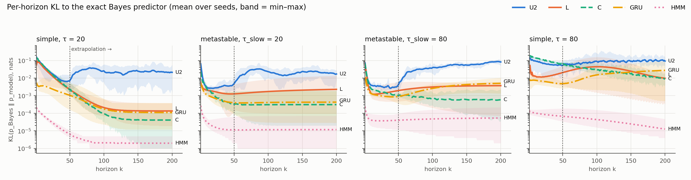
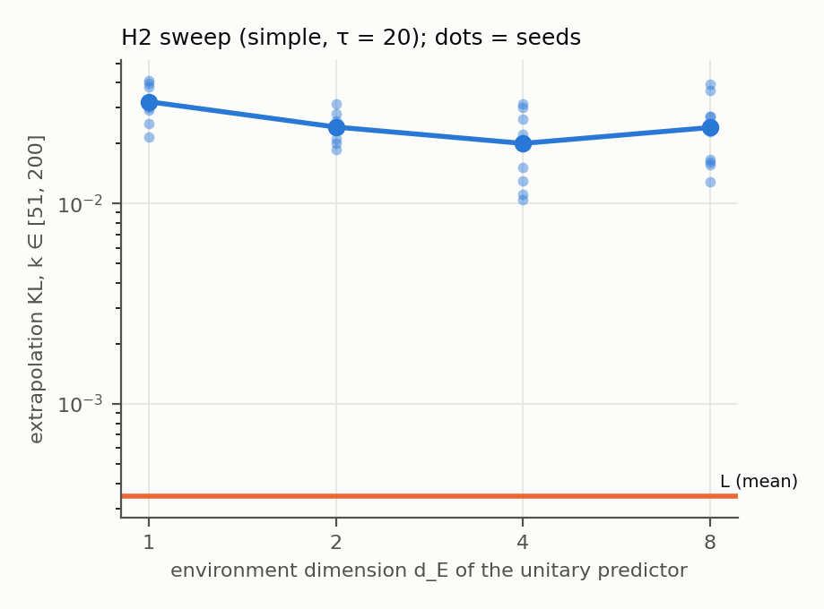
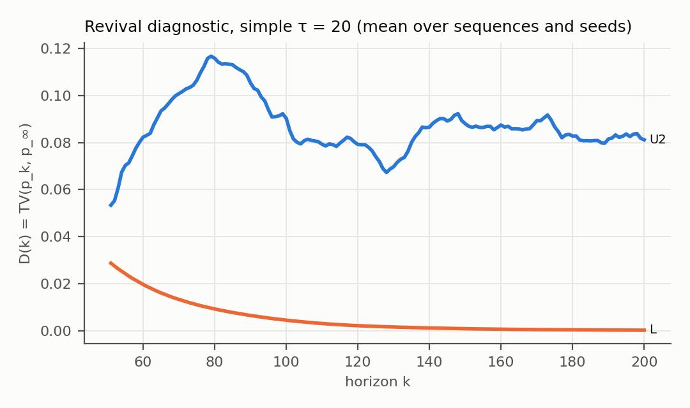

# Open-system versus unitary density-matrix predictors on long-horizon predictive error: a pre-registered comparison against an exact Bayes reference

**Author:** Jiaxuan Chen, Omytea

**Status:** Technical report, 2026-11-07. Not peer reviewed. Before release the report went through eleven rounds of internal correctness review, each including an independent recomputation, from the raw run records, of the results within that round's scope, and an internal check of its wording against what the results support; those records are not published. The pre-registrations and designs are published in English in the supplement (`docs/`); their binding Chinese originals are hash-committed, and the supplement README lists each one's SHA-256 and timestamp proofs. The other records cited below are English versions of originals that were not hash-committed and carry no independent timestamp (each document's header states the time evidence available); the development-gate diagnosis is published as a summary. Code, run records and analysis scripts are in the supplement under `repro/experiments/open-system-world-model/`; file paths in this report are relative to that folder unless they start with `docs/`. The result numbers of the confirmatory and post hoc analyses in the running text are listed with their sources in `report/numbers.json`; the tables are rendered directly from the run records and summary files by the same script, so not every table entry has its own registry entry, and development-phase values and task properties quoted in the running text are taken directly from the run records, code or designs (the script is not included); values quoted from a later follow-up experiment (§5, Scope of H1) and from an internal check of it are taken from those records, which are not published; the rank-4 K representability check in §3.2 is reproduced by `report/check_k_representation.py`. All planned experiments have been run except the pre-registered H5 approximate replication, which was not run (§3.6).

**Licence:** Copyright 2026 Jiaxuan Chen. This report is licensed under CC BY 4.0 (https://creativecommons.org/licenses/by/4.0/); the code in the supplement is licensed under the Apache License, Version 2.0. Third-party data keep their own licences (Data and acknowledgements).

**One-sentence argument:** On synthetic partially observed Markov processes with an exact Bayes reference and about 10³ parameters, a unitary density-matrix predictor, trained under the registered learning-rate selection, carries measurable excess predictive error beyond its training horizon when the target is already close to stationary (0.0237 nats above the GKSL predictor L on the simple task with τ = 20, pre-registered, ten seeds; met on one of the two registered tasks — the metastable task gave 0.0189, below the 0.02 threshold), for a blind rollout that applies the unitary dynamics without marginalising the observation instrument (the rollout convention we read in the UWM-JEPA paper; our unitary predictor is re-implemented from that paper's specification, not its code, and no result is claimed for UWM-JEPA itself). In these near-stationary configurations, contraction towards a stationary state alone sufficed to remove that error (kill test KT3, judged against the GKSL predictors L and L1); in the registered extrapolation windows, which contain a single relaxation rate, the general GKSL generator adds nothing beyond it (a test of a two-timescale mechanism was not possible there), and neither a recurrence attribution nor a dose–response in the environment dimension is established: the excess is an undamped oscillation that returns near earlier predictions inside the window, so H1 cannot separate recurrence from absence of contraction, and the rank test of the dose–response depends on the choice of test (§4.1). Applying the instrument's non-selective channel at each blind step of the same trained weights removed nearly all of the excess (post hoc, no retraining; §5), so the excess depends on the rollout convention; that post hoc channel removes excess rather than adding signal: at τ = 20 the window holds almost no signal, and at τ = 80, where it does, the channel applied to the trained weights captured almost none of it (§5). Where the extrapolation window still carries real signal (τ = 80; post hoc captured fractions), the trained L and C captured little of it on the simple task (0.12 and 0.21), while on the metastable task the contraction-type models captured 0.73–0.94. In a further matched-parameter comparison, density-matrix sequence models did not meet the pre-registered margin over flexible classical recurrent networks on any arm or budget, and, descriptively, were behind them on the weakly measured qutrit clock and on two of three real streams; the registered conclusion of that comparison is, however, not accepted, because its positive control failed. A separately pre-registered follow-up (E3) found that, on the HQMM-generated process where that comparison's gradient training had stalled, a moment-matching warm start fitted to training-sequence pair and triple statistics, followed by fine-tuning, let the density-matrix model of the true order capture at least 90% of the predictable information on 10 of 10 fresh seeds, with the gain attributed by the registered rule to the warm start rather than to matched compute (recipe M, unlike the comparison recipes, was developed on exploratory seeds of the same process; the attribution is relative to the registered comparison recipes, all started at random, and unregistered pilots started near the identity reached the bar on some seeds without a moment warm start, §5); it did not transfer to a weaker-signal instance of the same family (0 of 10), and in development runs it did not reach the bar on a d = 4 clock (three seeds, descriptive).

---

## 1. Introduction

**¶1 Context.** Several recent world models represent belief as a density matrix and evolve it between observations with a learned map. When that map is unitary, as in a recent belief-state JEPA design (UWM-JEPA; Radha & Goktas, arXiv:2605.25313, 2026), the spectrum of the joint system–environment belief is preserved exactly, so the predictor cannot dissipate the uncertainty it represents; the authors limit this "non-forgetting" to the joint state, since the reduced state can still lose probe-accessible information. They present the property as a feature. They also list long-horizon retention (beyond k = 10 rollout steps) as an open question and name hidden Markov chains among the settings their results do not cover.

**¶2 Bottleneck.** A finite-dimensional unitary evolution is almost periodic in Bohr's sense (Bohr, Acta Math. 45, 29–127, 1925), so its predictions return arbitrarily close to earlier ones (Bocchieri & Loinger, Phys. Rev. 107, 337–338, 1957, prove that the state returns arbitrarily close to its initial state when the spectrum is discrete; the predictions, being continuous in the state, inherit this, and for iterates of a fixed unitary the return follows from simultaneous approximation of the eigenphases). A process whose predictive distribution relaxes to a stationary law cannot be tracked at every horizon by such a predictor. That unitary dynamics cannot forget is not new. For input-driven quantum reservoirs with a density-matrix state, a system without dissipation cannot forget its initial state (Chen & Nurdin, Quantum Inf. Process. 18, 198, 2019), and a contraction condition is necessary and sufficient for the echo-state and fading-memory properties (Martínez-Peña & Ortega, Phys. Rev. E 107, 035306, 2023; §2). For classical networks, Jing et al. (Neural Computation 31(4):765–783, 2019) show empirically that orthogonal and unitary RNNs lack the ability to forget; they argue that complete forgetting is not possible with a composition of orthogonal transformations alone, because each new rotation is chosen before the current state is seen, and they add gating. The almost-periodicity argument above is another elementary route to the same conclusion. What is specific here is the object: a predictive distribution rolled out without observations, whose target relaxes to a stationary law, with the resulting excess error measured against an exact Bayes reference. Open-system (completely positive, trace-preserving) transition channels can contract towards a stationary state; combined with an observation instrument and conditional normalisation, they reproduce exact HMM filtering and prediction (the known inclusion of HMMs in HQMMs: Monràs, Beige & Wiesner, Applied Mathematical and Computational Sciences 3, 93, 2011, arXiv:1002.2337, §4.3, write every HMM with d hidden states as an HQMM with d internal states; restated for a system dimension at least the number of hidden states as Proposition 2 in `docs/theory-notes.en.md`). The channels alone are not the Bayes filter: the conditional update is nonlinear. A unitary model with an observation instrument is itself an open system in this sense: when an outcome is measured but not observed, marginalising it replaces the selective update by the instrument's non-selective channel ρ ↦ Σ_y K_y ρ K_y†, which can contract (Monràs, Beige & Wiesner, §4.1, describe this map as performing the measurement and "forgetting the outcome"). What separates the unitary and open-system predictors compared here is therefore the operator applied at blind steps, not whether the model as a whole is open. In the literature we searched (¶3), we found no measurement of whether this difference matters at the horizons and model sizes used in practice.

**¶3 Gap and measure.** In the literature we searched, we found no comparison that combines three things: a density-matrix belief, CPTP and unitary predictors of matched nominal size (§3.2 also gives the parameters that training actually updates), and an exact Bayes reference. With that reference we measure, per horizon, KL(p_Bayes ‖ p_model): the expected excess log loss of the model's predictive distribution over the Bayes-optimal one. This is a measure of *predictive error*. It is not the same as reliability calibration — a forecast can be reliable on average and still lose information — so we report expected calibration error (ECE) separately. `docs/literature-search-record.en.md` records the search behind the narrowed gap statement, and `docs/literature-search-2026-11.en.md` the later searches, including the quantum reservoir computing literature, which the first search did not cover. It is a statement about our search, not a priority claim.

**¶4 This study.** We pre-registered (v1, 2026-10-19; `docs/preregistration-v1.en.md`) and, after a failed development gate, re-registered with documented deviations (v1.1, 2026-10-21; `docs/preregistration-v1.1.en.md`) a comparison of the following predictors on synthetic tasks with exact Bayes predictions, trained on horizons 1–50 and evaluated to 200:
- unitary predictors with environment dimension 1, 2, 4 or 8;
- a GKSL (Lindblad) predictor;
- a Kraus-channel predictor;
- an "ordinary contraction" control;
- classical baselines.

The confirmatory comparison finds the phenomenon on the simple task but not its mechanism. In every T1 density-matrix predictor, unitary and open-system alike, the blind rollout applies only the dynamics and skips the instrument's non-selective channel, so it is not the marginal of the model's own filter (§5, Scope of H1); for the unitary predictor this leaves no contraction at all. The unitary predictor's extrapolation-window KL exceeds the GKSL predictor's by 0.0237 nats (pre-registered threshold 0.02). A contraction-only control has extrapolation-window error equal to or lower than the GKSL predictor's, so kill test KT3 restricts the conclusion to "contraction". Two further, separately frozen analyses compare density-matrix models with classical ones on real pedestrian headings (E1), and at matched parameter budgets on HQMM-generated processes and three real streams (E2). A third (E3) tests whether a moment-matching warm start removes the HQMM training failure that E2 exposed. We report every outcome, including errors in our own pipeline:
- a floating-point comparison in the frozen analysis code (D13);
- a positive control whose budgets were set where the known effect was either capped below the 0.10 margin (64 parameters) or had vanished (256) (diagnosed post hoc), which invalidates E2's registered conclusion;
- a learning-rate grid and step budget that left the contraction control C under-trained, and a single-seed learning-rate selection that left L under-trained on most simple τ = 20 seeds (both found post hoc);
- an E1 classical baseline (the HMM) fitted on more of each training sequence than the neural models were;
- in E3, a compute check that failed because classical replica counts were frozen at development-time CPU prices, and a registered prediction (equivalence of HQ(2) and OOM(3) at the true order) that was badly miscalibrated.

## 2. Related work

- **Density-matrix and quantum-inspired sequence models.** These are CPTP/Kraus or density-like sequence models, mostly without actions, and none with an observation-free long-horizon analysis against an exact Bayes reference:
  - hidden quantum Markov models (Monràs, Beige & Wiesner, Applied Mathematical and Computational Sciences 3, 93, 2011, arXiv:1002.2337; Srinivasan, Gordon & Boots, AISTATS 2018, PMLR 84:1979–1987; Adhikary et al., AISTATS 2020, PMLR 108:4151–4161);
  - QSWM, whose density-matrix variant uses a rank-one real latent ρ = vvᵀ/Tr(vvᵀ) updated by a congruence ρ ↦ AρAᵀ followed by explicit trace renormalisation (the congruence is completely positive; the trace renormalisation makes the update nonlinear, so it is not a CPTP channel), evaluated on elementary cellular automata (Jiang et al., arXiv:2608.05371, 2026);
  - a sentence-level density matrix passed through an evolution module that combines a GRU, a Lindblad-master-equation layer and a complex-valued block, then measured for sentiment classification (LI-QiLM; Yan, Lai & Wang, NAACL 2024, pp. 2112–2121);
  - Kraus-parameterised (CPTP) belief updates, conditioned on the measurement–action history and regressed onto a simulator's density matrix, used for feedback control of a simulated continuously monitored qubit (Singh & Bhatia, arXiv:2608.15715, 2026); the same authors evaluate recursive Kraus-structured updates over T = 2000 steps against ground-truth conditional density matrices, with the measurement record on throughout and no unitary arm (Singh & Bhatia, arXiv:2603.05468, 2026, workshop paper).
  - *Limitation tied to this paper:* in our reading, none of these compares CPTP with unitary predictors against an exact Bayes reference.
- **Unitary and orthogonal recurrent networks.** Gated orthogonal recurrent units add forgetting to orthogonal RNNs (Jing et al., Neural Computation 31(4):765–783, 2019; arXiv:1706.02761). A Lindblad-inspired classical reservoir obtains controllable forgetting from dissipation (Beuria & Shukla, arXiv:2608.04028, 2026); for density-matrix reservoirs the role of dissipation was established earlier (next bullet).
  - *Limitation:* classical vector states; excess error against an exact reference is not measured.
- **Quantum reservoir computing: dissipation, echo-state property and fading memory.** A fixed, input-driven quantum system, whose density matrix is updated by a CPTP map at each input, is read out by a trained linear map; to approximate fading-memory input–output maps it must forget its initial state (the echo-state, or convergence, property). That this requires dissipation, and that contraction towards a fixed state supplies it, is established there:
  - the original scheme alternates unitary evolution with an input injection that replaces one qubit's state, a CPTP map ρ ↦ ρ_{s_k} ⊗ Tr₁ρ (Fujii & Nakajima, Phys. Rev. Applied 8, 024030, 2017), which later work reads as a dissipative erase-and-write map;
  - Chen & Nurdin (Quantum Inf. Process. 18, 198, 2019) state that without dissipation such a system cannot be convergent, prove convergence when each input's map, restricted to traceless Hermitian operators, has induced norm at most 1 − ε, and show that a class of such dissipative systems is universal for fading-memory maps;
  - Chen, Nurdin & Yamamoto (Phys. Rev. Applied 14, 024065, 2020) use at each step an input-weighted mixture of two maps (unitary in their hardware subclass) followed by a reset to a fixed state σ with probability ε ∈ (0, 1], which bounds the ‖·‖₁ distance between trajectories by 2(1 − ε)^L after L steps; our contraction control C (§3.2) has this form, without input dependence;
  - Martínez-Peña & Ortega (Phys. Rev. E 107, 035306, 2023) show that, for a continuous reservoir on a compact input set, a contraction condition on the traceless part is necessary and sufficient for the echo-state and fading-memory properties;
  - Sannia et al. (Quantum 8, 1291, 2024) state that dissipation is necessary and that unitary Hamiltonian dynamics are not sufficient, and show that continuous local losses reproduce erasing maps and, with tuned damping rates, can improve on them;
  - Morguí-Sancho et al. (arXiv:2607.14311, 2026, preprint) note that strict contractivity excludes unitary maps, which preserve distances between states, and that averaging over measurement outcomes yields a CPTP map that can supply the missing dissipation;
  - for channels without inputs, unitary channels have infinitely many fixed states and so are neither ergodic nor mixing (Burgarth et al., New J. Phys. 15, 073045, 2013).
  - *Limitation tied to this paper:* these works study fixed, input-driven reservoirs and whether their state forgets its initial condition; there, an input-independent fixed point means lost input memory, whereas in a prediction rollout without observations relaxation to a fixed state is the target. None of them trains the reservoir dynamics or measures predictive error against an exact Bayes reference. Where they forecast autonomously (Fujii & Nakajima; Sannia et al.), the trained readout's output is fed back as the next input and the target is a chaotic or periodic signal, not a relaxing law. We claim no novelty for the need for dissipation or for contraction as the remedy.
- **Probabilistic and density-matrix JEPA world models.**
  - UWM-JEPA uses a learned unitary predictor on a density-matrix latent over a joint system–environment space (d_sys = 8, d_env = 2, i.e. a 16 × 16 joint density matrix) (Radha & Goktas, arXiv:2605.25313, 2026);
  - Branch-JEPA (Song et al., arXiv:2607.05238, 2026) and MDN-VJEPA (Huang, arXiv:2610.13956, 2026) are probabilistic JEPA world models with ordinary vector latents.
  - *Limitation:* no open-system comparison and no hidden-state filtering task; MDN-VJEPA does report excess NLL over a generator oracle in controlled branching settings.
- **Moment and spectral initialisation of latent sequence models.** Moment and spectral estimators are established for HMMs and observable operator models (Jaeger, Neural Computation 12(6):1371–1398, 2000; Hsu, Kakade & Zhang, J. Comput. Syst. Sci. 78(5):1460–1480, 2012; Anandkumar et al., JMLR 15:2773–2832, 2014), and refining a moment estimate by likelihood is a classical complement: Anandkumar et al. (2014) note that one Newton–Raphson step on the likelihood from a moment estimator (after Le Cam) can give an asymptotically efficient estimator. Closest to E3, ordered roughly by closeness:
  - for classical HMMs, lagged pair moments with model expressions taken at the stationary distribution (lags up to 10 in the experiments) are fitted by least squares through convex reformulations to estimate the transition matrix, with the observation matrix known or estimated in a separate first step; initialising maximum likelihood with such estimates is called a promising hybrid but is not tested (Mattila et al., ICML 2020, PMLR 119:6785–6796). The supplementary material, printed as pp. 81–104 of Mattila's KTH doctoral thesis (Hidden Markov Models: Identification, Inverse Filtering and Applications, 2020, TRITA-EECS-AVL-2020:26), adds lagged non-consecutive triples with a stationary-state model expression and shows that pair moments at any lag do not identify an HMM in general, while third-order moments separate the counter-example. An earlier paper combines spectral learning of HMMs with likelihood maximisation (Mattila et al., CDC 2017, pp. 5859–5864, DOI 10.1109/CDC.2017.8264545);
  - gate-set tomography seeds a gate-set model by linear inversion from gate sequences of length at most 3 and refines it by likelihood, without imposing complete positivity (Blume-Kohout et al., arXiv:1310.4492, 2013, preprint); later versions fit in stages on circuits of increasing depth, each stage seeded by the last (chi-squared in early stages), finish with maximum likelihood on all data, and offer CPTP parameterisations (Nielsen et al., Quantum 5, 557, 2021, DOI 10.22331/q-2021-10-05-557), implemented in the open-source pyGSTi package (Nielsen et al., Quantum Sci. Technol. 5, 044002, 2020). The data come from designed circuits, not passively observed sequences;
  - quantum process identification models a repeated process as a time-local process on the system plus an effective environment, estimates the model dimension from the singular values of a generalised Hankel (Ho–Kalman) matrix of outcome frequencies, seeds the model by a weighted low-rank factorisation of that matrix, refines it from low- to high-repetition-count blocks, and finishes with a likelihood stage approximated by weighted least squares; the model has no complete-positivity constraint (Bennink & Lougovski, New J. Phys. 21, 083013, 2019, DOI 10.1088/1367-2630/ab3598);
  - in quantum optics, second- and third-order photon correlations of a driven atom–cavity Lindblad model are computed from its steady state by the quantum regression theorem, in the same form as M's model tables (§3.9) but in continuous time and for a single detected channel, and compared with measured g²(τ) and g³(τ₁, τ₂), with the theory curves averaged over an atomic-position distribution tuned to the data and a fitted vertical scaling of up to 10% (Koch et al., Phys. Rev. Lett. 107, 023601, 2011); QuTiP provides steady-state two-time correlation functions (Johansson, Nation & Nori, Comput. Phys. Commun. 184, 1234–1240, 2013); GKSL models are fitted to measured lifetime and g²(τ) data by reversible-jump MCMC from random starts (Wallace et al., Phys. Rev. Research 7, 033217, 2025); open quantum systems with instantaneous feedback are shown to be HQMMs (Clark et al., arXiv:1406.5847, 2014);
  - HSE-HQMM initialises a kernel-embedded density-matrix sequence model by two-stage regression (a moment-based estimator) and refines it by backpropagation through time; because the regressed parameters only approximately satisfy the quantum constraints, it projects the state back to a valid density matrix at each step rather than imposing an exact Kraus constraint (Srinivasan, Downey & Boots, NeurIPS 2018, arXiv:1810.12369);
  - for positivity-constrained automata, a spectral estimate of a quadratic weighted automaton (which squares a weighted automaton's output, a Born-rule-like construction) is proposed as the starting point for likelihood maximisation instead of random parameters; in its experiments a spectral estimate followed by one likelihood-gradient step was most often the best of four methods (Bailly, ACML 2011, PMLR 20:147–162); norm observable operator models have an isometry constraint, a constructive estimator built from estimated word probabilities (outlined in principle; the authors note it is not yet practical) and a polar-factor projection onto valid models (Zhao & Jaeger, Neural Computation 22(7):1927–1959, 2010);
  - quantum hidden Markov models, parameterised for learning as unitary circuits with mid-circuit measurement, are fitted directly to empirical distributions of short words by a divergence plus a circuit-complexity penalty, with local optimisers inside an evolutionary search; the fit is the whole objective rather than a warm start, and model probabilities start from a fixed initial state rather than the stationary state (Markov et al., arXiv:2212.03796, 2022);
  - spectral reconstruction of minimal-dimension realisations of finitely correlated states (a class that includes HQMM-generated states) from estimated marginals on contiguous blocks, with trace-norm stability bounds, from tomography on copies of a quantum chain state (Fanizza et al., arXiv:2312.07516, 2023); and a necessary-and-sufficient condition for when a stationary process admits a finite-dimensional completely positive realisation, a characterisation rather than a learning algorithm (Monràs & Winter, J. Math. Phys. 57, 015219, 2016);
  - for maximum-likelihood training of Kraus-form HQMMs from random initialisations, getting stuck in local optima is reported for larger models (Srinivasan, Gordon & Boots, AISTATS 2018), and COSM optimises on the Stiefel manifold (Adhikary et al., AISTATS 2020).
  - *Limitation tied to this paper:* E3's recipe M is an instance of this established strategy, and we claim no novelty for warm-starting by moments. E3 contributes a pre-registered measurement on fresh seeds against an exact reference, with a compute-matched random-restart control (C1) and oracle-start controls. It does not compare M with the initialisers above.
- **Recurrence of finite quantum systems.** Bocchieri–Loinger recurrence (Phys. Rev. 107, 337–338, 1957) and Bohr almost periodicity (Acta Math. 45, 29–127, 1925).

## 3. Methods

### 3.1 Tasks

All tasks are hidden Markov processes with S = 8 hidden states and O = 4 observation symbols. Their observation processes are exactly 4-state HMMs (post hoc, internal review r8; checked to 4 × 10⁻¹⁵): states s and s + 4 can be merged on the simple and action tasks, and s and s + 2 within each block on the metastable task. S = 8 is therefore not the minimal hidden dimension.

- **Emission matrix.** On the simple and action tasks, state s emits symbol s mod 4 with probability 0.7 and each other symbol with probability 0.1.
- **T1-simple.** P = λC + (1 − λ)Π, with:
  - C the 8-cycle permutation;
  - Π = 1πᵀ, where π is the uniform distribution;
  - λ = e^{−1/τ}.
  Because CΠ = ΠC = Π, Pᵏ = λᵏCᵏ + (1 − λᵏ)Π, so the k-step predictive distribution is available in closed form.
- **T1-metastable.** Two blocks of four states. Inside a block the chain rotates and relaxes with τ_fast = 3: W = e^{−1/3}C₄ + (1 − e^{−1/3})Π₄, with C₄ the 4-cycle permutation and Π₄ the 4 × 4 matrix with every entry 1/4. Every step it mixes globally with probability 1 − e^{−1/τ_slow}.
  - *Emission (changed before any confirmatory run, deviation D6).* Block A emits s mod 2 and block B emits 2 + (s mod 2), with probability 0.7.
  - *Why the change.* With the original emission the two blocks emit identically. The observation process then collapses exactly to a four-state single-rate chain, and the slow mode becomes invisible (development-gate diagnosis, finding D02; `docs/development-gate-diagnosis-summary.en.md`).
  - *Visible decay times with the revised emission.* The inter-block mode decays exactly with τ_slow (20 or 80). The fast observable mode decays with 2.61 (τ_slow = 20) or 2.89 (τ_slow = 80). The frozen texts give the slow values as 19.99 and 80.14; these equal −1/ln λ with the slow eigenvalue λ rounded to four decimals (0.9512 and 0.9876), so they are rounding artefacts.
- **T1-action.** Two actions select the rotation direction (C or Cᵀ) of the simple task.
- **Protocol.**
  - Sequences start from the stationary law; the context is 32 observations.
  - Models then predict k = 1…200 steps ahead without new observations.
  - Each seed draws 20,000 training, 2,000 validation and 2,000 test sequences from an independent generator, seeded with 10,000·seed + task key.
  - Training uses k ∈ [1, 50] only; k ∈ [51, 200] is the extrapolation window.
- **Bayes reference.** Exact forward filtering on the context, then propagation with Pᵏ.
- **Configurations run.** Simple τ ∈ {20, 80}; metastable τ_slow ∈ {20, 80}; action τ = 20. Simple τ = 80 is secondary. The v1 task list also contained simple τ = 5, which no hypothesis uses; it was not run.

### 3.2 Predictors

**Shared instrument.** All T1 density-matrix predictors share one quantum instrument with O outcomes on the d_S = 8 system:
- M_o = A_o S^{−1/2}, where S = Σ_o A_o†A_o;
- readout p(o) = Tr(M_o ρ M_o†);
- update ρ ← M_o ρ M_o† / p(o).

The instrument starts near the identity. The predictors differ only in the dynamics between observations:

| Name | Dynamics between observations | Parameters (1 / 2 actions): nominal [movable under Adam training] |
|---|---|---|
| U(d_E) | ρ ← U(a)ρU(a)† on system ⊗ environment, U(a) = exp(−i(H₀ + aH₁)), a ∈ {−1, +1}, d_E ∈ {1, 2, 4, 8}. U2 matches the 8 × 2 latent configuration reported for UWM-JEPA (re-implemented from the paper's specification, D1), trained here with the same blind multi-horizon NLL as the other gradient-trained models (the HMM uses EM on the joint sequence likelihood; D14). | 640 / 1,024 / 2,560 / 8,704 [576 / 768 / 1,536 / 4,608] (U1–U8, one action) |
| L | GKSL channel exp(𝓛) with 𝓛(ρ) = −i[H(a), ρ] + Σ_{j=1}^{3} (L_j ρ L_j† − ½{L_j†L_j, ρ}); the jump operators do not depend on the action (D12). | 1,024 / 1,152 [960 / 1,024] |
| L1 | As L with one jump operator, parameter-matched to C for H3. | 768 / 896 [704 / 768] |
| K | One CPTP map per action, from rank-4 Kraus operators obtained from an isometry V = G(G†G)^{−1/2}. | 1,024 / 1,536 [1,024 / 1,536] |
| C | Unitary rotation followed by contraction towards a learned state σ at a learned rate ("ordinary contraction" control). | 769 / 897 [705 / 769] |
| GRU | Hidden size 15; a "no observation" token during the blind rollout. | 1,099 / 1,144 [1,024 / 1,114] |
| LRU | Diagonal complex linear recurrence, 20 states, MLP readout of width 16. | 1,004 / 1,044 [1,004 / 1,044] |
| HMM | 8 states, EM on the first 5,000 training sequences, best of 3 restarts. | 87 / 143 (fitted probabilities) |

- **Representability.** The L family contains the exact predictor of T1-simple when it has seven jump operators (numerical error 2 × 10⁻¹⁵; `docs/theory-notes.en.md`). Rank-4 K does contain an exact predictor of T1-simple at both relaxation times (found by internal review round 6; `report/check_k_representation.py`): with X the cyclic shift on the eight states, λ = e^{−1/τ}, Kraus operators K_j = √w_j X^j (j = 0…3) with w = ((1−λ)/4, λ + (1−λ)/4, (1−λ)/4, (1−λ)/4) and the diagonal instrument M_o = diag(√B[:, o]) reproduce the Bayes predictive to 4 × 10⁻¹⁵ (1.6 × 10⁻⁷ in the registered float32 class). Three-jump L, the registered size, contains an exact predictor as well; this supersedes the theory draft's three-jump approximation with maximum transition-matrix error of about 0.006 (found by internal review round 8; checked by the author in double precision to 2 × 10⁻¹⁴): H = i·log X, with X the cyclic shift |s⟩ ↦ |s+1⟩, jump operators L_j = √(1/(4τ)) X^j (j = 1, 2, 3) and the same diagonal instrument. C also contains it (rotation X, target σ = I/8, retention λ).
- **Matched sizes.** Every comparison that enters a hypothesis is matched to within ±10% in nominal trainable parameters (deviation D9; checked by a unit test). U4 and U8 are deliberately larger: they form the dimension sweep of H2. The bracketed counts subtract, for every family alike, the parameter directions that Adam training never moves (`report/param_audit.py`, post hoc, internal reviews r5 and r7): coordinates whose gradient is always zero, and groups of coordinates with identical or opposite gradients on every batch, which Adam's element-wise update keeps tied. Two structures produce them. H₀ and H₁ are stored as full complex matrices of which only the Hermitian part enters the model, so the anti-Hermitian half of each (n² reals for an n × n matrix) keeps its initial value. In the GRU the reset- and update-gate input and hidden biases are duplicates, and with one action the constant action input duplicates the input biases. Counted this way the match fails for the U2–L pair, which enters H1 and H2's revival component: U2 has 768 movable parameters against L's 960 (ratio 0.800). The H4 baseline GRU has 1,024 against 960 (ratio 1.067) on the one-action tasks and 1,114 against 1,024 (ratio 1.088) on the action task, and H3's C has 705 against L1's 704 (ratio 1.001): all three within ±10% by this count. Movable is not the same as identifiable: some movable directions leave every prediction unchanged (for the density-matrix models, the joint change of system basis, the instrument normalisation and U's environment basis). The local identifiable dimension, the numerical rank of ∂ log p/∂θ at a random parameter point (`report/ident_audit.py`, post hoc, internal review r9), is U2 633, L 813, L1 569, C 508, K 813 and LRU 867 on the one-action tasks (each with a clear spectral gap). By this count U2/L = 0.78, C/L1 = 0.89 and LRU/L = 1.07, so only the last pair is within ±10%. The GRU shows no clear spectral gap at this test size (singular-value ratio at the threshold 1.02), so its identifiable dimension is not determined; the softmax readout alone fixes 16 movable directions, which bounds it by 1,008 (GRU/L ≤ 1.24). No conclusion depends on the closer match. For H3, C has fewer identifiable dimensions than L1 and still had the lower extrapolation KL on the metastable task, the opposite of H3's prediction. For H1 the mismatch runs the other way: U2, the model expected to be worse, is the smaller one, so the mismatch could inflate U2 − L; against L1, which has fewer identifiable dimensions than U2 (569 against 633), U2 − L1 = 0.0237 nats (post hoc, §4.1). H2 is not met, so a mismatch that could favour its revival component changes no conclusion. H4 is report-only. The action-task U2 and L, unmatched in nominal count (1,536 and 1,152), have 1,024 and 1,024 movable parameters and 888 and 876 identifiable dimensions (ratio 1.01). Gauge directions that Adam does move are not subtracted from any count, e.g. the instrument's normalisation, K's isometry map, the trace of each H (a global phase for U and C, cancelling in L's commutator) and the unitary freedom of C's contraction target σ.
- **Compute.** Per-forward FLOPs are reported in `docs/report-notes-excerpt.en.md` as lower bounds: matrix exponentials, element-wise operations and normalisation are not counted, and complex matrix multiplications are counted as single complex operations, so their roughly fourfold real-arithmetic cost is not reflected.

### 3.3 Training and model selection

- **Optimiser.** Adam, batch 64, gradient-norm clipping at 5, 6,000 steps.
- **Loss.** For the gradient-trained models, NLL averaged over all horizons k = 1…50 of the blind rollout. This equals in expectation the pre-registered "k sampled uniformly from 1–50". The HMM is not trained on this loss: it is fitted by EM to the joint likelihood of whole observed sequences (context and future, one-step conditionals), on the first 5,000 training sequences, keeping the best of 3 restarts by training likelihood. The pre-registered common-loss statement therefore holds for the neural and density-matrix models only, and comparisons involving the HMM carry this difference (deviation D14).
- **Learning rate.** For each (task, τ, model) the learning rate is chosen from {3 × 10⁻³, 10⁻²} by validation NLL (first 1,000 validation sequences) on a single development seed, 102.
- **Why these settings (deviation D5).** They come from a probe on development seed 101. On development seed 100, under the original 2,000 steps and learning rates {10⁻³, 3 × 10⁻³}, L, K and C stalled at an in-range KL of about 0.03 and the unitary models stayed at 0.035–0.068. On development seed 101 with 6,000 steps, L reached 0.0034 at learning rate 10⁻² but stayed at 0.0294 at 3 × 10⁻³, and K reached 0.0019–0.0031. Development seed 102 then selected 3 × 10⁻³ for L (0.0062 there). Choosing the learning rate on a single seed turned out to be fragile (§4.1, "Convergence").
- **Logged per training run.** Initial validation NLL, the pre-clipping gradient norm every 200 steps, and the final parameters (D11). Logging was verified not to change training: the outputs are bit-identical with and without it.
- **Development gate before confirmatory runs (D7).** All development jobs finished. The models with a known learnable solution, and U2 at its chosen learning rate, have validation NLL below ln 4 − 0.003. All unit tests pass.

### 3.4 Metrics

Per horizon k:
- KL(p_Bayes ‖ p_model), the excess log loss over the Bayes predictor;
- NLL;
- Brier score;
- ECE with 10 bins.

Window means: in-range, k ∈ [1, 50]; extrapolation, k ∈ [51, 200].

**Revival index** (pre-registration §4, operationalised in D4). For each sequence:
- p_∞ is the mean prediction over k ∈ [400, 600], computed from a separate rollout of 500 contexts;
- D(k) = TV(p_k, p_∞);
- the index is the number of strict local maxima of D on [51, 200] times their mean height (a dimensionless sum of total-variation distances).

The index is then averaged over sequences.

### 3.5 Hypotheses and statistics

Thresholds are fixed in v1 and unchanged in v1.1.

| Hypothesis | Rule |
|---|---|
| H1 | U2 − L extrapolation KL ≥ 0.02 nats on simple and on metastable, τ = 20. |
| H2 | Spearman ρ ≤ −0.8 between d_E ∈ {1, 2, 4, 8} and extrapolation KL, and U2 − L revival index > 0 (simple, τ = 20). |
| H3 | On metastable τ_slow = 80, C − L1 ≥ 0.01 nats. On simple τ = 20, C and L1 are equivalent within ±0.01 nats (TOST). |
| H4 | L is non-inferior (margin 0.01 nats) to the classical baseline with the lowest development validation NLL, on simple, metastable and action, τ = 20. Report only. As implemented, only GRU and LRU were eligible (see below). |
| H5 | Approximate replication of the UWM-JEPA hidden-velocity result (0.77 ± 0.05). **Not run** (§3.6). |

**Statistical procedure.**
- Ten confirmatory seeds (0–9), one run per configuration; a missing seed makes a test INCOMPLETE.
- Each test uses paired differences across seeds, with bootstrap (10,000 resamples) and t 95% intervals.
- **Superiority tests** (H1, H3 metastable, H2 revival component): one-sided paired t test against 0. PASS requires the effect-size rule, both intervals excluding 0, and Holm-adjusted p < 0.05.
- **Equivalence** (H3 simple): two one-sided tests against ±0.01 nats.
- **Non-inferiority** (H4): one-sided test of L − baseline against +0.01 nats, decided by Holm-adjusted p < 0.05 (as in the frozen code). The v1.1 clause "both intervals exclude 0" is written for superiority; for non-inferiority we read it, as a post hoc interpretation (internal review r2), as "both upper limits below +0.01", which all three tests also satisfy. These intervals may contain 0.
- **Holm family.** Seven tests: H1 × 2, H2, H3, H4 × 3. A conjunctive hypothesis takes the maximum of its component p-values (v1.1 §6; D8 names H2's Spearman and revival components explicitly).
  - The frozen analysis code departs from this for H2: it applies the rank component as a fixed threshold with no p-value, so its H2 p-value is the revival component's alone (deviation D14). Table 1 reports both the frozen code's Holm values and the Holm values under the registered conjunction, in which the rank component's p-value is its exact one-sided permutation p. The protocol did not name the rank test; the exact permutation test is our post hoc choice, and the asymptotic Spearman test leads to the same verdict.
  - The H4 baseline was chosen among models with a recorded development validation NLL. In the frozen pipeline the HMM recorded none, so the eligible set was effectively {GRU, LRU} (finding F3/B7). §4.1 reports a sensitivity analysis with the HMM eligible.
- **Kill test.** KT2 is triggered if H1 at τ = 20 shows a difference below 0.01 nats with an interval crossing 0.
- **Code and protocol.** The analysis code (`src/osw/analyze.py`) is part of the frozen code manifest. Its unit tests plant an effect, plant a null, drop one seed, and check that the H4 baseline is chosen on development data only. After the internal reviews it was changed (post hoc, D14) to compute the registered H2 conjunction with the exact permutation p of the rank component, and to write any re-run to `RESULTS-RERUN-<time>` instead of overwriting the frozen `runs/confirm/RESULTS.*`. Run on a copy of the confirmatory files, it reproduces the registered-conjunction verdicts and Holm values in Table 1.

### 3.6 Pre-registration history and deviations

| Date (UTC) | Event | Evidence |
|---|---|---|
| 2026-10-19 12:09:22 UTC | v1 exists no later than this time (frozen) | SHA-256 `37172954…`; DigiCert and Sectigo RFC 3161 tokens; Bitcoin block 972141 |
| 2026-10-19 | v1 development gate FAIL; confirmatory seeds untouched | `runs/dev/GATE.md`; separate internal read-only diagnosis (summary: `docs/development-gate-diagnosis-summary.en.md`) |
| 2026-10-21 | Deviations D5–D11 recorded; the repository history places them before the confirmatory start | `docs/deviations-D1-D16.en.md` |
| 2026-10-21 20:04 | Round-2 development gate PASS on re-run (the 20:03 run reported 10 HMM/BAYES files as missing because of a filename mismatch; the fix changed no result, D11) | `runs/dev2/GATE.md`, `runs/chain2.log` |
| 2026-10-21 20:08:10–20:08:15 UTC | v1.1 (token 20:08:10) and its manifest of every source and test file and of the round-2 development results (token 20:08:14) exist no later than these times (frozen); the local run log records the confirmatory start at 20:08:46 UTC | SHA-256 `d0199a7a…` (addendum) and `4036f2e7…` (manifest); RFC 3161 tokens; OpenTimestamps proofs in Bitcoin blocks 972525 and 972552 (not used to order the freeze against the runs; run start times come from the local run log) |
| 2026-10-21 20:08 | Confirmatory phase started (450 runs) | `runs/chain3.log` |
| 2026-10-22 08:41 | Machine restart at 181/450; resumed at 10:36 after re-verifying the manifest | `runs/chain3.log` |
| 2026-10-22 20:40 | Confirmatory phase complete; analysis run | `runs/confirm/` |

**Deviations (full text in `docs/deviations-D1-D16.en.md`):**
- **D1.** The unitary baseline is implemented from the paper, because the public repository has no training code. KT1 is redefined as unit tests of that implementation (unitarity, trace, positivity, symmetry), which pass. The H5 approximate replication on a reconstructed hidden-velocity task was planned but **never implemented or run**; it remains outstanding, and no H5 result is reported.
- **D2.** The gradient-trained models use the same blind multi-horizon NLL; the HMM uses EM on the joint sequence likelihood (D14).
- **D3.** All T1 density-matrix models share one instrument.
- **D4.** Definition of the revival index.
- **D5.** Training budget and learning-rate grid.
- **D6.** Metastable emission; H3 moved to τ_slow = 80. The frozen rationale, that both time scales are visible in the extrapolation window at τ_slow = 80, is wrong: only the slow mode is visible there (internal review r8; a dated correction is appended to `docs/deviations-D1-D16.en.md`).
- **D7.** Gate scope.
- **D8.** Analysis corrections: seed completeness, Holm in PASS, H3 equivalence test, H4 baseline chosen on development data.
- **D9.** Parameter matching and L1.
- **D10.** v1 stopped at its gate; v1.1 re-registered.
- **D11.** Run-time diagnostics and the filename bug.
- **D12.** Action-independent jump operators in L (disclosure only).
- **D13.** Floating-point rank threshold in the frozen H2 code (post hoc; found after reading the confirmatory output). Exact arithmetic makes the threshold itself hold at its boundary, but this does not decide H2 (D14).
- **D14.** Implementation departures found by the internal correctness reviews: (a) the frozen code tests H2's rank component as a threshold, not as a p-value in the conjunction the protocol specifies; (b) the HMM is fitted by EM to the joint sequence likelihood rather than the common blind multi-horizon loss; (c) the H4 baseline selection could not select the HMM, which recorded no validation NLL; (d) in E1 the HMM and the reference predictors are fitted on whole training sequences, not the six-step training window; (e) after the confirmatory analysis, `analyze.py` was changed to implement the registered H2 conjunction and never to overwrite the frozen `RESULTS.*` files (post hoc; the frozen outputs are unchanged); (f) in T1, E1 and E2 the HMM is fitted on the first 5,000 training sequences or windows, not the full training set the frozen texts specify (§3.7, §3.8).
- **D15, D16.** E3 deviations, recorded after the E3 freeze (§3.9).

**Labelling.** Under v1 §5, every analysis after these changes is exploratory relative to v1. It is confirmatory relative to v1.1. D13 and every robustness analysis in §4 are post hoc.

**Code provenance.** Result files record the repository HEAD at the end of each run, which changed with unrelated commits during the run. The source files in the frozen manifest that the runs execute (`models.py`, `run.py`, `tasks.py`, `hmm.py`, `queue.py`) were unchanged throughout. `analyze.py` and `test_analysis.py` changed afterwards (D13, D14(e)), and `queue_e1.py` changed afterwards to emit JSON. `run_e1_hmmtw.py`, which writes the post hoc E1 refits, was added in round 4 and is not part of any registered run.

### 3.7 Exploratory real-data analysis (E1)

E1 has its own design (`docs/E1-design.en.md`); its binding Chinese original (SHA-256 `f06879ca…`) exists no later than its RFC 3161 tokens (2026-10-21, 15:51 UTC); the repository history records the first E1 code after that time. An OpenTimestamps proof (Bitcoin block 972502) is a later upper bound.
- **Data.** ETH (BIWI Walking Pedestrians; Pellegrini et al., ICCV 2009) and UCY (Crowds-by-Example; Lerner et al., Comput. Graph. Forum 26(3), 2007) pedestrian tracks at 0.4 s per step, obtained through OpenTraj; their terms grant no redistribution right, so the supplement provides a fetch script with the expected file hashes.
- **Observations.** Nine symbols: eight heading sectors relative to the last moving context heading, plus a stationary symbol.
- **Horizons.** Eight-step context; the gradient-trained models are trained on k ∈ [1, 6]; evaluation to k = 12.
- **Not all models see the same training window.** The HMM is fitted by EM to whole training sequences: the context plus all twelve future steps, so it also sees steps 7–12 of the *training* sequences (not of the test sequences). The MARG and MARKOV1 reference predictors are also estimated from whole training sequences. This departs from the frozen design's training-window statement for these models; §4.2 adds a post hoc sensitivity fit of the HMM on the six-step window (D14(d)).
- **Splits.** Leave-one-scene-out, with train and validation split by pedestrian; five folds × three seeds.
- **Training.** Adam, batch 64, 6,000 steps; learning rate from {3 × 10⁻³, 10⁻²}, chosen per (held-out scene, seed) by validation NLL. The HMM, MARG and MARKOV1 have no learning rate.
- **Dropped windows.** As the frozen design requires, windows whose context is entirely stationary are dropped. Kept / dropped per scene: eth 2,256 / 87, hotel 736 / 339, univ 10,657 / 3,003, zara01 2,015 / 79, zara02 2,886 / 2,668.
- **HMM training subset.** As in T1, the HMM is fitted on the first 5,000 training windows only, while the gradient-trained models use all of them (7,112–16,240 per fold and seed). Training windows are concatenated scene by scene, so this subset omits whole scenes: with eth or hotel held out it contains no zara01 or zara02 windows, with zara01 held out no zara02, and with zara02 held out no zara01; only the univ fold's subset contains all four training scenes. The post hoc six-step refit (§4.2) keeps the same subset.
- **Parameter counts.** Not matched: U2, L and K have 1,664 parameters, C 1,409, GRU 1,404 and LRU 1,289.
- **Intervals.** Bootstrap over the five folds. The frozen summary drew 10,000 Monte Carlo resamples (generator seed 20261021); with five units there are only 5⁵ = 3,125 equally likely ordered resamples, and one Monte Carlo endpoint (HMM − L, lower) shifted by about 0.009 across 50 generator seeds in an internal recomputation. Table 3 therefore reports, post hoc, percentiles over all 3,125 ordered resamples (exact enumeration, same statistic and percentile rule; `report/exact_ci.py`).

E1 is descriptive only and enters no hypothesis.

### 3.8 Matched-parameter comparison of density-matrix and classical sequence models (E2)

E2 has its own design (`docs/E2-design.en.md`) and addendum (`docs/E2.1-addendum.en.md`); their binding Chinese originals (SHA-256 `b953bbe1…` and `4cec19f1…`) both exist no later than their RFC 3161 tokens (2026-10-22, 11:51 and 14:43 UTC); the local run log records the first E2 run after the second token. As recorded in the addendum, it ran concurrently with the confirmatory phase; this affects run time, and results only at the level of floating-point summation order.

- **Model families and size ladders.**
  - HQ(d), d ∈ {2, 3, 4, 6, 8}: the standard hidden quantum Markov model with one Kraus operator per observation, taken from one isometry.
  - GRU(h), h ∈ {2, 4, 8, 16}.
  - LRU(n), n ∈ {2, 4, 8, 16}.
  - HMM(n), n ∈ {2, 4, 8, 16, 32}.
  - The T1 density-matrix models are not used. During the blind rollout they apply only their observation-independent dynamics, whereas an HQMM propagates with its non-selective channel Σ_y K_y ρ K_y†; the T1 recursion therefore does not in general implement the HQMM recursion. E2 uses the standard HQMM parameterisation so that the generating processes are guaranteed to lie in the HQ class.
- **Arm A (exact reference).** Data are generated by small HQMMs: A1, the probability clock (two states, two symbols; Zhao & Jaeger, 2010, used as an HQMM benchmark by Srinivasan, Gordon & Boots, AISTATS 2018, §5.1); A2, a weakly measured rotating qutrit with relaxation time 20. Context 32; training and evaluation on k = 1…20; 20,000/2,000/2,000 sequences per seed; five seeds.
  - **Metric.** Captured fraction = 1 − mean_{k≤10} KL(exact ‖ model) / mean_{k≤10} KL(exact ‖ m), where m is a per-seed empirical approximation of the stationary marginal (the mean exact prediction at k = 20 over that seed's test contexts), as implemented.
- **Arm B (real streams).** Five symbols (quintile categories); context 26; k = 1…8; three seeds.
  - *B — weekly temperature quintiles.* ERA5T weekly-mean 2 m temperature (Hersbach et al., 2020) on a 1.5° grid, categorised against the 20-year weekly quintile climatology, 134 weeks, as provided to registered participants of ECMWF's AI Weather Quest (Loegel et al., Machine Learning: Earth 1, 010701, 2025; see Data and acknowledgements). Training windows lie within weeks 0–80, validation uses held-out grid points from the same period, and test windows lie within weeks 81–133. Sampling is area-weighted.
  - *B2/B3 — household appliance energy and New York City taxi demand.* The `Appliances` column of the UCI "Appliances energy prediction" dataset (Candanedo et al., Energy and Buildings 140, 2017; doi:10.24432/C5VC8G; CC BY 4.0) and 30-minute taxi passenger counts from the Numenta Anomaly Benchmark (file `realKnownCause/nyc_taxi.csv`; Ahmad et al., Neurocomputing 262, 2017; MIT licence), aggregated by Numenta from NYC Taxi & Limousine Commission trip records; both converted by us to quintile categories. Time split 60/10/30; quintile thresholds from the training part only; every window used.
  - **Metric.** RPSS over steps 3–6 against uniform climatology.
- **Training.** Adam, batch 64, 6,000 steps. Learning rate from {3 × 10⁻³, 10⁻²}, chosen per (arm, family, size, seed) by validation NLL. HMM by EM with 3 restarts, on the joint sequence likelihood. As in T1, the HMM is fitted on the first 5,000 training sequences or windows only, while HQ, GRU and LRU use all of them: 20,000 sequences in A1 and A2, 20,000 randomly sampled windows in B, and 11,808 and 6,159 time-ordered windows in B2 and B3, where the HMM therefore saw only the earliest 42% and 81% of the training period. HQ − HMM contrasts, including the A1 positive control, therefore differ in training-set size (and, in B2 and B3, temporal coverage) as well as in objective, optimiser and representation. Both sides cover the same horizons (k ≤ 20 in the A arms).
- **Comparison.** Each family's mean metric is interpolated linearly in log(parameters) at fixed budgets: {64, 256} for A and {150, 500} for B. Seeds are resampled jointly across families (10,000 bootstrap replicates).
  - **Rule.** HQ − best of GRU/LRU ≥ 0.10 with CI > 0 receives the registered label "advantage" (parameter efficiency at that budget, on these data only).
  - **Positive control.** HQ − HMM on A1 must meet the same rule.
  - **Stop rule.** If neither A1 nor A2 meets the rule at either budget, conclude that density-matrix models have no parameter-efficiency benefit over flexible classical models even on HQMM-generated data, and stop pursuing the direction that the design names "density matrices bring a predictive advantage".
  - **Validity condition.** If the positive control fails, the main conclusion is not accepted until the cause is found.
- **Interval scope.** Intervals reflect variation across run seeds (initialisation, batch order, and for A and B the data sample) on the selected datasets and splits. They do not cover temporal or population generalisation. With three or five seeds there are only 27 or 3,125 ordered resamples. The frozen summary drew 10,000 Monte Carlo resamples (generator seed 20261022); Table 4 instead reports, post hoc, percentiles over every ordered resample (exact enumeration, same shared-seed statistic; `report/exact_ci.py`). The registered advantage labels are those of the frozen summary; no label changes under exact enumeration.

### 3.9 Moment-matching warm start for gradient-trained HQMMs (E3)

E3 asks whether the A2 training failure of E2 (§4.3) is an optimisation problem that a warm start can avoid. It has its own design (`docs/E3-design.en.md`; binding Chinese original SHA-256 `69a5ad9c…`, revision 2 after two internal design reviews and a development gate on seeds 200–204) and a frozen code manifest (aggregate hash `628a28ec…`, recorded in every run file). The design and the manifest file (SHA-256 `118501c0…`; the file lists every source file with its hash and records the aggregate) exist no later than their RFC 3161 tokens (2026-10-24, 15:57:50–15:57:59 UTC, two authorities); the run files, using the local clock, record every confirmatory job as starting later (earliest recorded start 2026-10-24T16:02:51Z). OpenTimestamps proofs of the same two hashes are anchored in Bitcoin blocks 972947–972959; their block times were not checked here, so they are not used to order the freeze against the runs. Confirmatory seeds are 20–29, disjoint from all earlier seeds. E3 changes none of E2's registered verdicts. Before the freeze, the registered compute rule removed, in its fixed order, the OOM(9) arm on A2, the above-order HQ(4) arm, the classical robustness replicas, the σ = 0.2 oracle level, the model arms on the d = 4 process A3, an A2w LRU check and the GRU/LRU rungs at size 32. Two deviations were recorded after the freeze (`docs/deviations-D1-D16.en.md` D15, D16): the reason for keeping A3, which the design required before the freeze, was registered late (A3's confirmatory model arms had been cut and never ran; its confirmatory reference-predictor jobs and fixture checks did run, and recipe M and oracle starts had run on it at the development gate, §4.4); and development plus confirmatory CPU was projected to exceed the 32 CPU-hour cap, which by design changed nothing (development plus confirmatory CPU was 29.2 hours).

- **Model.** HQ(d) as in E2: the Kraus operators K_y (y = 1…O) are the d × d blocks of an isometry V ∈ ℂ^{Od×d}, obtained from an unconstrained complex matrix G by the polar map V = G(G†G)^{−1/2}. The model filters the 32-symbol context from the maximally mixed state ρ₀ = I/d (ρ ← K_y ρ K_y†, then trace normalisation) and predicts k = 1…20 by repeated application of the channel ρ ↦ Σ_y K_y ρ K_y†; it is not started in its own stationary state. (The sequences start from the generator's stationary law, which is I/d for A2 and A2w but not for A1. With the true Kraus operators loaded, the model's predictions after the 32-symbol context match the exact predictive to within 8.4e-07 on A1, A2 and A2w (fixture PC-D), so the start does not matter for the true model; for fitted models the two starts can differ.) Training uses E2's loss (hard-target multistep NLL over k = 1…20), Adam with batch 64 and gradient clipping at 5 in single-precision complex arithmetic, and the last checkpoint. Initialisation seeds are 10⁷ + 10⁴·seed + 10³·c + r, with recipe code c (M 0, C1 1, S 2, C2 3) and restart index r. No selection uses the test set.
- **Recipe M (moment-matching warm start, then fine-tuning; fixed in the timestamped design, which the run records place before the confirmatory runs).** Its settings were fixed after exploratory diagnosis on A2 itself (seeds ≥ 300; see Threats).
  1. From the training sequences only, compute empirical pair tables P(y_t, y_{t+k}) for k = 1…10 and triple tables P(y_t, y_{t+k₁}, y_{t+k₁+k₂}) for (k₁, k₂) ∈ {1, 2, 3}², pooled over every position of the full 52-symbol training sequences (context and prediction window), each table normalised to sum to 1.
  2. Compute the same tables exactly for the candidate HQMM, started from an approximation of its stationary state: 400 applications of the channel ρ ↦ Σ_y K_y ρ K_y† to I/d, then trace normalisation. For a slowly mixing candidate this is not yet the stationary state, so the tables are exact conditional on that start. This start is used only for the moment tables; the model itself filters from I/d. The moment loss is the sum over tables of KL(empirical ‖ model).
  3. Minimise the moment loss from 48 random starts (each real component of G drawn from N(0, 0.5²); start r uses seed 10⁷ + 10⁴·seed + r) with L-BFGS in double precision (learning rate 1, history 20, strong-Wolfe line search, at most 150 iterations, gradient tolerance 10⁻¹², change tolerance 10⁻¹⁴). Keep the start with the lowest training moment loss. No validation data, test data or generator parameters enter this step; the model order d is set to the generator's true order.
  4. Load G = V_sel·P with P = diag(linspace(1, 1.6, d)). The polar map returns V_sel up to single-precision rounding, since V P (P²)^{−1/2} = V for an isometry V and positive-definite P; the scaling avoids the repeated eigenvalue at which the eigendecomposition-based backward pass of the polar map is undefined.
  5. Fine-tune with Adam at learning rate 3 × 10⁻³ for 3,000 steps, decaying linearly to 0, with the batch generator seeded with the run seed (20–29).
- **Comparison recipes for HQ(3) on A2 (54 real parameters).**
  - *C0, the unchanged E2 protocol:* the frozen E2 training script, learning rates 3 × 10⁻³ and 10⁻² at 6,000 constant-rate steps each, keeping the run with lower validation NLL. It is not compute-matched to M.
  - *C1, compute-matched random restarts with decay:* R1 = 6 random initialisations of G (each real component N(0, 0.5²)), each trained with Adam at learning rate 10⁻² for 6,000 steps with linear decay to 0 and with its batch generator seeded with its initialisation seed; the restart with the lowest validation NLL is kept. R1 was frozen at the development gate as the smallest value in {3, …, 6} for which R1 times the development CPU per restart reached M's median development CPU.
  - *S, a Stiefel-manifold optimiser* re-implemented after COSM (Adhikary et al., AISTATS 2020, arXiv:1912.02098), with the settings below: V parameterised directly on St(Od, d) and initialised as the polar map of a complex Gaussian (each real component N(0, 0.5²)); the same loss, batch 64 and filter start ρ₀ = I/d as HQ(d), in double precision, with neither Adam nor gradient clipping; Wirtinger gradients normalised before and after momentum 0.9, Cayley retraction with step τ_t = τ₀·0.9^{t/313} (t = 0, 1, …), τ₀ = 0.1 (chosen at the development gate), six restarts of 6,000 steps, each with its batch generator seeded with its initialisation seed, selected by validation NLL.
  - *C2, oracle start (diagnostic only, never a capability comparison):* G₀ = V_true + σ(Z_re + iZ_im) with independent standard normal components, followed by M's fine-tuning step. O05 denotes σ = 0.05.
- **Processes** (all from the stationary state, context 32, prediction k = 1…20). For each process and seed, new training, validation and test sequences are drawn (generator seed 10,000·seed + a process code, as in E2); every arm on that process uses the same draw. Counts are per seed.
  - *A1:* the probability clock of E2 (two states, two symbols), 20,000 / 2,000 / 2,000 sequences.
  - *A2:* E2's weakly measured qutrit clock (relaxation time 20 steps), 20,000 / 2,000 / 2,000.
  - *A2w:* the same family with weaker measurement (ε = 0.15; relaxation time about 94 steps; about 0.003 nats of predictable information over k ≤ 10), 120,000 / 2,000 / 10,000.
- **Other model families (true order on A1, ladders on A2).**
  - *OOM(3)-C on A1* (17 free parameters): an observable operator model with spectral and moment-matching initialisations, each fine-tuned for 3,000 steps; the candidate set also contains the spectral model before fine-tuning, and selection is by validation NLL. Outputs are clamped at 10⁻⁶ and renormalised before scoring.
  - *HMM(n)-C on A1:* moment-matching initialisation, then Baum–Welch on all 20,000 training sequences, plus three randomly initialised EM runs; the fit with the best training likelihood is kept. (Unlike T1, E1 and E2, the E3 HMM uses every training sequence.)
  - *GRU and LRU:* four probes (two initialisations × two learning rates, 750 steps), the best by validation NLL continued with its Adam state for 9,250 steps with linear decay. On A2 at sizes 2–8, the best of R_c independent replicas is kept, with R_c frozen so that each size receives about the development CPU of HQ(3)-M.
- **Metric.** Captured fraction (CF) over k ≤ 10, exactly as in E2 (§3.8).
- **Registered rules** (ordered tables executed by the frozen summary code; every count rule is reported with a one-sided 95% Clopper–Pearson bound, listed in Table 5). E3 rule names carry the prefix "E3-" to distinguish them from T1's H1–H5.
  - *E3-H1:* a seed succeeds if M reaches CF ≥ 0.90 on A2. With s successes out of 10: s ≤ 6 → KILL, s ≥ 9 → PASS, otherwise PARTIAL; UNINTERPRETABLE if the oracle-start validity gate PC-A fails.
  - *E3-H2:* the same bar for S: s ≥ 9 → reached, s ≤ 1 → not reached, otherwise PARTIAL.
  - *E3-H3a / E3-H3b (transfer to A1 / A2w):* a seed succeeds if CF(M) ≥ 0.95·CF(O05) and CF(M) ≥ 0.50; a seed whose own O05 run has CF < 0.50 counts as unsuccessful. On A1, success also requires CF(M) ≥ CF(C0) − 0.01. s ≤ 5 → KILL, s ≥ 9 → PASS, otherwise (s = 6–8) PARTIAL. E3-H3a is judged whatever the E3-H1 label. E3-H3b is judged by the rule only if E3-H1 is PASS (if E3-H1 is PARTIAL it is only described). It also needs a median O05 CF ≥ 0.50 on A2w, both at the development gate (otherwise A2w is removed before the freeze) and on the confirmatory seeds (otherwise "statistically limited, not judged").
  - *E3-H4 (basin locality):* the share s(σ) of seeds with CF ≥ 0.90 from oracle starts at σ ∈ {0.05, 0.1, 0.3}; s(0.3) ≤ 0.2 → "local", s(0.3) ≥ 0.6 → "non-local", otherwise undetermined. The σ = 0.05 share is the PC-A data and carries no separate conclusion.
  - *E3-H5 (attribution to the warm start):* Δ5 = mean CF(M) − max(mean CF(C0), mean CF(C1)). Mean CF(C1) ≥ 0.80 → refuted (compute and decay suffice); interval lower bound ≥ 0.40 and mean CF(C1) ≤ 0.50 → established; otherwise undetermined. "Established" must hold both with and without runs that hit NaN.
  - *E3-H7 (positivity equivalence on A1, true order; judged only if PC-O passes and E3-H3a is not KILL):* Δ7 = mean[CF(HQ(2)-M) − CF(OOM(3)-C)]. Interval inside [−0.03, 0.03] → equivalent; Δ7 ≥ 0.05 with lower bound > 0 → "HQ better under these recipes", relabelled "OOM optimisation failure" if OOM's fine-tuned CF falls below its spectral initialisation; the mirror case → OOM better; otherwise uncertain.
  - *Demoted before the freeze:* a parameter-efficiency rule against GRU/LRU (E3-H6) and its stop rule. In the development gate's planted-truth simulation the rule mislabelled a censored case at rate 0.287, above the 2.5% bar.
- **Intervals.** The resampling unit is the seed; seeds are resampled jointly across arms. BCa, 10,000 resamples (seed 20261025). The development gate's coverage simulation gave 0.8815 for nominal 95% intervals on paired differences, below the 0.94 bar, so under the single registered fallback the difference rules (E3-H5, E3-H7 and the control PC-B) use 97.5% intervals. The design also required the coverage after the fallback to be reported; it had not been measured, and the same simulation, run unchanged at release with its own seed, gives 0.9205 for the nominal 97.5% intervals (post hoc; `report/e3_coverage.py`). These intervals are therefore narrower than their label.
- **Controls.** PC-D (fixtures: exact predictor scores 1, marginal 0, loaded true Kraus operators reproduce the exact predictive); PC-A (O05 learns A2: CF ≥ 0.90 on at least 8 of 10 seeds and median CF ≥ 0.95; validity gate for E3-H1 to E3-H5); PC-B (HQ(2)-M − HMM(4)-C ≥ 0.10 on A1 with interval lower bound > 0, the known HQMM-over-HMM contrast of Srinivasan et al., 2018, §5.1); PC-K (the classical pipelines reproduce their E2 levels); PC-O (OOM implementation, A1 median ≥ 0.95); NC (a context-shuffled exact predictor scores ≤ 0); a compute check (classical replicas receive ≥ 0.8 times HQ(3)-M's CPU; it gated only E3-H6); and PC-C, a modifier asking whether the E2 protocol reproduces the stall on the new seeds (mean C0 ≤ 0.30 and at least 8 of 10 seeds below 0.30 → reproduced; mean C0 > 0.50 → not reproduced; otherwise partly reproduced). PC-C sets the wording of the E3-H1 conclusion and does not gate it.
- **Predictions and verification.** The author's predictions for 10 rules and controls were written after the development gate (`docs/predictions.en.md`) and their predicted probabilities are stored in the frozen summary code, which exists no later than the manifest's token and which the run records place before any confirmatory job; they are scored by multiclass Brier score. They replace the probabilities in the design's §6, which were written before the development gate and are kept only as history (for E3-H7, "uncertain" 0.17 there against 0.08 in the scored block). After the run, two internal, mutually blind recomputations from the raw records (written independently with AI coding assistants from two model families; not external review) reproduced every registered label and statistic; one of them nevertheless returned MISMATCH, on implementation grounds (§4.4).

## 4. Results

### 4.1 Confirmatory comparison (v1.1, seeds 0–9)

All 450 confirmatory runs completed. Before any result was read we checked that every source file matched the time-stamped code manifest and that every result recorded the frozen addendum hash; both checks passed (`docs/T1-results-adjudication.en.md`).

**Table 1. Pre-registered tests.**

| Hypothesis | Contrast (unit) | Mean | Bootstrap 95% CI | t 95% CI | Holm p, frozen code | Holm p, registered conjunction | Verdict |
|---|---|---|---|---|---|---|---|
| H1, simple τ=20 | U2 − L, extrapolation KL (nats) | 0.0237 | [0.0217, 0.0260] | [0.0211, 0.0264] | 1.6e-08 | 2.1e-08 | PASS |
| H1, metastable τ_slow=20 | U2 − L, extrapolation KL (nats) | 0.0189 | [0.0163, 0.0212] | [0.0159, 0.0219] | 2.7e-07 | 3.6e-07 | NOT MET |
| H2, simple τ=20 | revival index U2 − L (dimensionless); rank threshold over d_E | 4.26 | [3.95, 4.59] | [3.87, 4.65] | 4.2e-09 (revival component only) | 0.333 | NOT MET under the registered conjunction (rank component: exact permutation p = 0.167; the verdict depends on the choice of rank test, see below); the frozen code also reported NOT MET, via a floating-point rank threshold (D13, D14) |
| H3, metastable τ_slow=80 | C − L1, extrapolation KL (nats) | -0.0022 | [-0.0033, -0.0011] | [-0.0036, -0.0008] | 1.00 | 1.00 | NOT MET (opposite sign) |
| H4, simple τ=20 | L − GRU, extrapolation KL (nats); baseline chosen among GRU/LRU on development data | +0.00011 | [-0.00002, +0.00023] | [-0.00005, +0.00026] | 5.0e-16 | 5.0e-16 | non-inferior (margin 0.01; interpretation of the CI clause, §3.5) |
| H4, metastable τ=20 | L − GRU, extrapolation KL (nats); baseline chosen among GRU/LRU on development data | +0.00145 | [+0.00024, +0.00343] | [-0.00069, +0.00359] | 8.3e-06 | 1.3e-05 | non-inferior (margin 0.01; interpretation of the CI clause, §3.5) |
| H4, action τ=20 | L − GRU, extrapolation KL (nats); baseline chosen among GRU/LRU on development data | -0.00012 | [-0.00101, +0.00074] | [-0.00118, +0.00094] | 1.1e-08 | 1.4e-08 | non-inferior (margin 0.01; interpretation of the CI clause, §3.5) |

**Phenomenon.** On the simple task the unitary predictor U2 had higher extrapolation-window KL than the GKSL predictor L by 0.0237 nats (bootstrap 95% CI [0.0217, 0.0260]; t interval [0.0211, 0.0264]; Holm-adjusted p = 2.1e-08 under the registered conjunction, 1.6e-08 in the frozen code), which meets H1 on the simple task (one of the two registered H1 tasks). H1 concerns a blind rollout that applies the unitary dynamics without marginalising the observation instrument (§5, Scope of H1). Counted by parameters that Adam training can move (post hoc, §3.2), U2 has 20% fewer than L. The contrast was registered for U2; with the larger unitary models (post hoc) it is U4 − L = 0.0196 (t interval [0.0143, 0.0249]), just below the 0.02 threshold, and U8 − L = 0.0236 ([0.0171, 0.0301]). The excess error persists across the unitary sizes, but whether its point estimate crosses the registered threshold depends on the configuration. On the metastable task the difference was 0.0189 nats (CI [0.0163, 0.0212]); it is positive, but its point estimate is below the registered threshold, so H1 is not met there. Figure 1 shows the shape: on the simple τ = 20 panel the unitary predictor's per-horizon KL rises sharply after the end of the training window (k = 50) and then fluctuates, while L, C and GRU keep approaching the Bayes predictor. The other panels differ (seed-mean KL, post hoc). In the metastable panels L drifts upward after k = 50, far less than U2: from 0.0013 to 0.0023 at k = 200 for τ = 20 and from 0.0020 to 0.0037 for τ = 80, while U2 reaches 0.0171 and 0.0825. GRU is flat on metastable τ = 20 (0.00040 to 0.00043) but rises on metastable τ = 80 (0.00091 to 0.0050). On simple τ = 80, L rises to 0.0440 at k = 100, about half of U2's 0.0900, then falls back to 0.0098 by k = 200, while GRU rises steadily (0.0049 to 0.0275).

**Figure 1. Per-horizon KL to the exact Bayes predictor.** Confirmatory runs (v1.1, seeds 0–9; `runs/confirm/`), one panel for each of four of the five configurations run (§3.1; action τ = 20 is not shown); lines are seed means and shaded bands the minimum–maximum over seeds, for U2, L, C, GRU and the HMM. The training window ends at k = 50. Descriptive: drawn after the confirmatory analysis and not part of any registered test (`report/figures.py`).

**Convergence (post hoc, internal review B4).** The learning rate chosen on the single development seed did not make every comparison model converge on the confirmatory seeds. On the simple task:
- L stayed on the D5 plateau (in-range KL > 0.02) on 8 of 10 seeds;
- C stayed on it on 10 of 10. On the development seed C was on the plateau at both candidate learning rates (in-range KL 0.030–0.031), so the learning-rate grid and step budget, not the selection rule, left C under-trained;
- K converged on all ten (mean in-range KL 0.0017);
- U2's in-range KL averaged 0.033 on the confirmatory seeds. On development seed 101 it stayed between 0.037 and 0.051 under every D5 probe setting (learning rates 3 × 10⁻³ and 10⁻², 2,000 and 6,000 steps, two initialisations). But the unitary family is nested: with H = H_S ⊗ I, U2 reproduces U1 exactly, and likewise U4 contains U2 and U8 contains U4. No limit of the unitary class can therefore make U2 worse in range than U1, yet U2's confirmatory in-range KL (0.0325) exceeds U1's (0.0239) and U8's (0.0223). At least part of U2's in-range error is an optimisation shortfall; a unitary floor may exist but is not shown.

One confirmatory seed reached a lower U2 in-range KL (0.0168), so the structural-limit reading is not uniform.

H1 does not depend on L's convergence. Against the converged CPTP model K, the post hoc contrast is U2 − K = 0.0240 nats (CI [0.0219, 0.0262]) on the simple task and 0.0199 on the metastable task.

H1-simple does not depend on the parameter-count mismatch either (post hoc). Against L1, which has 704 Adam-movable parameters against U2's 768 and 569 identifiable dimensions against U2's 633 (§3.2), U2 − L1 = 0.0237 nats on the simple task (t interval [0.0209, 0.0264], 10 seeds).

H1 appears sensitive to the unitary model's learning rate (post hoc, one development seed, 102). On development seed 102, with L at its registered learning rate (extrapolation KL 0.00025), U2 − L was 0.0302 nats at U2's selected rate 3 × 10⁻³ and 0.0141 at 10⁻²; the second value is below H1's threshold of 0.02 nats on U2 − L. (U2's own extrapolation KL was 0.0304 and 0.0144.) The registered selection uses in-range validation NLL, which favoured 3 × 10⁻³. U4 and U8 show the same pattern (U − L 0.0137 vs 0.0069; 0.0508 vs 0.0033). On this seed, the size of the unitary excess is therefore not a property of the model class alone; it depends on which in-range fit the training procedure reaches.

**Table 2a. Mean extrapolation-window KL (k ∈ [51, 200]) per model, ten seeds.** The last column is the uninformative stationary-marginal predictor on the same test sets (post hoc).

| Configuration | U2 | L | L1 | K | C | GRU | LRU | HMM | U1 | U4 | U8 | Stationary marginal |
|---|---|---|---|---|---|---|---|---|---|---|---|---|
| simple-20 | 0.0241 | 0.0003 | 0.0004 | 0.0001 | 0.0002 | 0.0002 | 0.0004 | 0.0000 | 0.0322 | 0.0199 | 0.0239 | 0.0002 |
| metastable-20 | 0.0208 | 0.0019 | — | 0.0009 | 0.0003 | 0.0004 | 0.0013 | 0.0000 | — | — | — | 0.0001 |
| metastable-80 | 0.0490 | 0.0032 | 0.0029 | 0.0017 | 0.0007 | 0.0033 | 0.0139 | 0.0000 | — | — | — | 0.0120 |
| simple-80 | 0.0859 | 0.0287 | — | 0.0058 | 0.0258 | 0.0175 | 0.0231 | 0.0000 | — | — | — | 0.0326 |
| action-20 | 0.0043 | 0.0012 | — | 0.0004 | 0.0005 | 0.0013 | 0.0005 | 0.0000 | — | — | — | 0.0002 |

**Table 2b. Mean in-range KL (k ∈ [1, 50]) per model, ten seeds.**

| Configuration | U2 | L | L1 | K | C | GRU | LRU | HMM | U1 | U4 | U8 |
|---|---|---|---|---|---|---|---|---|---|---|---|
| simple-20 | 0.0325 | 0.0235 | 0.0055 | 0.0017 | 0.0311 | 0.0024 | 0.0045 | 0.0000 | 0.0239 | 0.0273 | 0.0223 |
| metastable-20 | 0.0056 | 0.0018 | — | 0.0011 | 0.0021 | 0.0009 | 0.0027 | 0.0000 | — | — | — |
| metastable-80 | 0.0062 | 0.0037 | 0.0038 | 0.0032 | 0.0044 | 0.0016 | 0.0042 | 0.0000 | — | — | — |
| simple-80 | 0.0734 | 0.0154 | — | 0.0144 | 0.1063 | 0.0062 | 0.0081 | 0.0001 | — | — | — |
| action-20 | 0.0376 | 0.0087 | — | 0.0043 | 0.0095 | 0.0124 | 0.0416 | 0.0001 | — | — | — |

**Dimension sweep (H2).** Mean extrapolation KL for d_E = 1, 2, 4, 8 was 0.0322, 0.0241, 0.0199 and 0.0239 nats (Figure 2; Figure 3 shows the revival diagnostic D(k) averaged over sequences and seeds; H2's revival component is computed per sequence).

**Figure 2. H2 dimension sweep.** Extrapolation-window KL (k ∈ [51, 200]) on the simple task, τ = 20, against the environment dimension d_E of the unitary predictor; dots are seeds, the line connects seed means, and L is shown as reference. Confirmatory runs (`runs/confirm/`). Descriptive.

**Figure 3. Revival diagnostic.** D(k) = TV(p_k, p_∞) on k ∈ [51, 200] for U2 and L on the simple task, τ = 20, averaged over the 500 long-rollout sequences of each seed and then over seeds. The revival index (Table 1) is computed from each sequence's own D(k) and then averaged, not from these averaged curves. Confirmatory runs. Descriptive.
- **Verdict: NOT MET.** Under the registered conjunction the H2 p-value is the larger of the rank and revival components. The registration requires a p-value for the rank component but names no test. The test used is an exact one-sided permutation of the four seed means: it gives p = 0.167, cannot give less than 1/24, and the Holm-adjusted p is 0.333. Given H3's raw p, which is last in the Holm order, this test could not have reached a Holm-adjusted p below 0.083, so it could not have met H2 whatever the four means were (post hoc calculation). The verdict therefore depends on the choice of test. On the 10 × 4 seed-level values (post hoc), Page's exact trend test with seeds as blocks gives one-sided p = 0.0156 (Holm 0.031, which would meet the threshold), and a t test on the per-seed correlations gives one-sided p = 0.034 (Holm 0.068, which would not). The frozen code also reported "not met", for a different reason: a floating-point comparison of ρ = -0.7999999999999999 with −0.8 (D13, D14).
- As an effect size, the exact Spearman correlation is −4/5, so the threshold ρ ≤ −0.8 holds only at its boundary. The d_E = 8 predictor has higher extrapolation KL than d_E = 4 and lower than d_E = 2 by just 0.00014 nats; a slightly larger U8 error would have given ρ = −0.4.
- The non-monotone shape may come from learning-rate selection rather than dimension (§5). The reversal that makes it non-monotone is not distinguishable from noise: U8 − U4 = +0.0040 (t interval [-0.0054, +0.0133]; post hoc), while U1 − U2 = +0.0081 ([+0.0038, +0.0124]) and U1 − U4 = +0.0123 ([+0.0062, +0.0184]).
- The revival index was larger for U2 than for L (4.26, CI [3.95, 4.59]). This component does not isolate revival. The index counts local maxima of D and multiplies by their mean level, not by their rise, so persistent oscillation scores high: U2's 4.34 comes from 43.9 peaks at about the level of its mean D (0.087), while C, with as many peaks (45.7) at a mean D of 0.0052, scores 0.26. Through the frozen function, a constant-amplitude period-4 rotation with no revival scores 3.7–4.7 and one genuine bump of height 0.05 scores 0.05 (post hoc). The difference mainly re-measures persistent oscillation and non-convergence; the development-gate diagnosis notes the same limitation (finding D06).

**Configurations with real extrapolation signal (simple τ = 80 is secondary; metastable τ_slow = 80 is the H3 configuration; captured fractions and the marginal-predictor reference are post hoc).** At τ = 20 the extrapolation window carries almost no predictable information (1.7e-04 nats on the simple task). Most learned models there are worse than a constant predictor (captured fraction L -0.98, C -0.31, GRU -0.37; K 0.52). At τ = 80 the window still carries real signal: 0.0326 nats on simple, 0.0120 on metastable. There:
- **Simple τ = 80.** L and C captured only 0.12 and 0.21 of the signal, against K 0.82, GRU 0.46 and the HMM 1.00; U2 was worse than the constant predictor (-1.63). C was on its plateau in range (per-seed median in-range KL 0.105; on the development seed 0.102–0.106 at both learning rates). L was less converged than K and GRU (median 0.015 against 0.006 and 0.006).
- **Metastable τ = 80.** The contraction-type models did well: C 0.94, L1 0.76, L 0.73, K 0.86 (GRU 0.72, LRU -0.16, HMM 1.00).

The KT3 finding that contraction alone removes the error is therefore a finding about near-stationary targets. Where real structure remains in the window, a contracting model must also fit that structure, and the ones we trained did so unevenly: on simple τ = 80, K captured 0.82 while L and C captured 0.12 and 0.21, and on metastable τ = 80 the contraction-type models captured 0.73–0.94. This describes these trained models, not a limit of contracting models.

**Beyond contraction (H3).** On the metastable task with τ_slow = 80, the contraction control C had *lower* extrapolation KL than the parameter-matched GKSL predictor L1 (C − L1 = -0.0022, CI [-0.0033, -0.0011]), and also lower than the native-size L (-0.0025). H3 is not met, with the opposite sign. This holds in the extrapolation window only: in range, C is worse than L1 (Table 2b). The test cannot speak to the two-timescale premise behind H3, however (post hoc, internal review r8): in the window [51, 200] the Bayes predictive's deviation from the marginal decays as a single exponential with time constant τ_slow (step ratio e^{−1/τ_slow} to within 10⁻⁵), because the fast observable mode (decay time 2.89) has fallen by about e^{−17} before k = 51. H3-metastable therefore tests single-rate relaxation, which C parameterises directly. The premise is visible only in range, where C is worse than L1 (0.0044 against 0.0038; post hoc). On the simple task the two were equivalent within ±0.01 nats (difference -0.00017, TOST p = 7e-16). That equivalence is uninformative, however, because the whole predictable signal in that window (1.7e-04 nats, Table 2a) is far below the margin.

**Non-inferiority to classical baselines (H4).** L was non-inferior, within 0.01 nats, to the baseline chosen among GRU and LRU on development data — GRU on all three tasks. The differences were +0.00011, +0.00145 and -0.00012 nats. Two qualifications:
- *Uninformative margin.* The margin is far larger than the predictable signal in this window (Table 2a): even the uninformative marginal predictor would pass. On the metastable task the point estimate favours GRU; the bootstrap interval excludes zero (+0.00024 to +0.00343) but the t interval does not (Table 1). Either way the difference is well inside the margin.
- *Sensitivity with the HMM eligible (post hoc).* With the HMM's validation NLL computed on development seed 102 only, the HMM is selected on all three tasks. L − HMM was +0.00034, +0.00186 and +0.00114 nats: non-inferior within the margin, but significantly positive on simple (t CI [+0.00020, +0.00049]) and action (t CI [+0.00056, +0.00173]). On metastable the bootstrap interval excludes 0 (+0.00059 to +0.00382) but the t interval does not (-0.00024 to +0.00395).

**Secondary metrics.** **Table 2c** gives the extrapolation-window means on the simple task. U2 is also worse in reliability calibration (ECE; descriptive, no test), not only in excess log loss; the other models are close to each other on every metric. Every metric for every run is in the per-run files under `runs/confirm/`.

| Metric (k ∈ [51, 200]) | U2 | L | L1 | K | C | GRU | LRU | HMM |
|---|---|---|---|---|---|---|---|---|
| NLL (nats) | 1.4106 | 1.3865 | 1.3865 | 1.3862 | 1.3863 | 1.3864 | 1.3865 | 1.3861 |
| Brier | 0.7615 | 0.7501 | 0.7501 | 0.7499 | 0.7500 | 0.7500 | 0.7501 | 0.7499 |
| ECE | 0.0621 | 0.0099 | 0.0106 | 0.0083 | 0.0086 | 0.0097 | 0.0098 | 0.0077 |

**Kill tests.** KT2 (difference below 0.01 nats with an interval crossing 0) is not triggered. KT3 is triggered: the contraction control is at least as good as the GKSL predictors L and L1 in the extrapolation window, and H2 is not met. Against the general Kraus predictor K, C is slightly worse at τ = 20 (simple +0.00015, t interval [+0.00003, +0.00026]; action +0.00011, [+0.00001, +0.00020]) and worse at simple τ = 80 (+0.0200, [+0.0095, +0.0305]), where C stayed on its in-range plateau (median in-range KL 0.105; post hoc). KT3 fires on either of its two clauses, so its firing does not depend on the H2 test. Under KT3 (named in the v1 pre-registration; its operational rule, that a contraction control as good as the CPTP predictor limits the conclusion to contraction, is stated in the planning note that v1 names as its upstream document; excerpt in `docs/planning-note-excerpt.en.md`), the main conclusion is therefore "contraction", not "recurrence".

**Predictions recorded during the confirmatory phase.** With 181 of 450 confirmatory runs complete, and stating that no confirmatory output had been read, the author recorded a probability for each verdict (`docs/predictions.en.md`; repository commit 2026-10-22 10:42 UTC; no independent timestamp). The outcome was broadly consistent with the qualitative picture recorded in advance: H1 simple, which passed, had been given 0.45, so the forecast leaned slightly against it; the mechanism attributions failed as forecast (H2 given 0.10 and not met; H3 given 0.05 and not met); and H4 held.

### 4.2 Real pedestrian headings (E1, exploratory)

**Table 3. Leave-one-scene-out results, 5 folds × 3 seeds.** Parameters are nominal counts of gradient-trained weights (for U2, L, C and GRU they include directions that Adam training never moves; §3.2), and fitted probabilities for the HMM and MARKOV1. MARG is recorded as 0 in the run files; it estimates 12 × (9 − 1) = 96 fitted probabilities. The Brier score, an auxiliary metric of the E1 design, is reported only in the per-run files. Intervals enumerate all 3,125 ordered fold resamples (§3.7). E1 is exploratory: rows are ordered by extrapolation NLL for reading only, and only differences against L are reported, as intervals without hypothesis tests (as the E1 design specifies).

| Model | Parameters | Extrapolation NLL, k ∈ [7,12] | In-range NLL, k ∈ [1,6] | RPS (moving), k ∈ [7,12] | ECE, k ∈ [7,12] | Δ NLL vs L | 95% fold-bootstrap CI (exact) |
|---|---|---|---|---|---|---|---|
| K | 1,664 | 1.1492 | 0.7730 | 0.0539 | 0.1608 | -0.0310 | [-0.0758, -0.0001] |
| HMM | 127 | 1.1571 | 0.7780 | 0.0546 | 0.1296 | -0.0231 | [-0.0723, +0.0199] |
| GRU | 1,404 | 1.1696 | 0.7964 | 0.0531 | 0.1547 | -0.0106 | [-0.0488, +0.0369] |
| C | 1,409 | 1.1697 | 0.7819 | 0.0537 | 0.1294 | -0.0104 | [-0.0526, +0.0226] |
| U2 | 1,664 | 1.1723 | 0.7765 | 0.0543 | 0.1548 | -0.0079 | [-0.0497, +0.0198] |
| L | 1,664 | 1.1802 | 0.7804 | 0.0546 | 0.1566 | +0.0000 | [+0.0000, +0.0000] |
| LRU | 1,289 | 1.3402 | 0.7966 | 0.0589 | 0.2207 | +0.1600 | [+0.1074, +0.2232] |
| MARKOV1 | 72 | 1.3769 | 0.9999 | 0.0598 | 0.1973 | +0.1967 | [+0.0916, +0.3270] |
| MARG | 0 | 1.4415 | 1.1685 | 0.0620 | 0.2232 | +0.2613 | [+0.1762, +0.3895] |

The learned sequence models (K, HMM, GRU, C, U2, L) lie within 0.031 nats of each other in extrapolation NLL, and most intervals against L include 0. K − L = -0.0310 (CI [-0.0758, -0.0001]) is driven by two of the five held-out scenes (-0.113 on univ, -0.041 on zara01); in the other three the difference is near zero. The HMM (127 parameters) reached an extrapolation NLL of 1.157, against 1.180 for L (1,664 parameters), but it was fitted on whole training sequences, including steps 7–12 (§3.7). Refitted on the six-step training window (sensitivity, post hoc; raw per-run files in `runs/e1-posthoc/`, written by `osw.run_e1_hmmtw`), it reached 1.200, +0.020 relative to L on average, with large differences between scenes. Both HMM fits also used only the first 5,000 training windows, which omit whole scenes in four of the five folds (§3.7). The HMM-versus-density-matrix comparison in E1 is therefore inconclusive. The D(k) revival diagnostic is in the per-run files under `runs/e1/`; it is descriptive only and does not change this picture.

### 4.3 Density-matrix versus classical sequence models at matched parameters (E2)

**Table 4. HQ − best classical model at fixed parameter budgets** (interpolated in log-parameters; seed bootstrap, exact enumeration of all ordered seed resamples; interval scope as in §3.8). The HQ − HMM column compares different fitting procedures (gradient training versus EM) and training sets (all training sequences versus the first 5,000) as well as different representations.

| Arm | Data | Metric | Budget | HQ − best of GRU/LRU (95% CI) | HQ − HMM (95% CI) |
|---|---|---|---|---|---|
| A1 | probability clock (HQMM-generated) | captured fraction, k ≤ 10 | 64 | +0.070 [+0.022, +0.141] | +0.070 [+0.044, +0.096] |
| A1 | probability clock (HQMM-generated) | captured fraction, k ≤ 10 | 256 | +0.009 [-0.004, +0.020] | -0.009 [-0.017, +0.001] |
| A2 | weakly measured qutrit clock (HQMM-generated) | captured fraction, k ≤ 10 | 64 | -0.378 [-0.444, -0.310] | +0.073 [+0.012, +0.133] |
| A2 | weakly measured qutrit clock (HQMM-generated) | captured fraction, k ≤ 10 | 256 | -0.303 [-0.508, -0.103] | +0.316 [+0.106, +0.527] † |
| B | ERA5T weekly temperature quintiles | RPSS, steps 3–6 | 150 | -0.001 [-0.004, +0.001] | -0.001 [-0.002, -0.001] |
| B | ERA5T weekly temperature quintiles | RPSS, steps 3–6 | 500 | -0.002 [-0.004, +0.000] | -0.003 [-0.004, -0.001] |
| B2 | household appliance energy | RPSS, steps 3–6 | 150 | -0.023 [-0.026, -0.021] | +0.038 [+0.031, +0.044] |
| B2 | household appliance energy | RPSS, steps 3–6 | 500 | -0.018 [-0.025, -0.012] | +0.035 [+0.025, +0.043] |
| B3 | New York City taxi demand | RPSS, steps 3–6 | 150 | -0.162 [-0.181, -0.153] | +0.053 [+0.048, +0.060] |
| B3 | New York City taxi demand | RPSS, steps 3–6 | 500 | -0.131 [-0.143, -0.122] | +0.070 [+0.054, +0.087] |

No entry meets the pre-registered rule (Δ ≥ 0.10 and CI > 0; registered label "advantage", meaning parameter efficiency at that budget), which is registered for HQ − best of GRU/LRU on every arm and for HQ − HMM on A1 (positive control) only. † marks an HQ − HMM contrast outside A1 that would meet the same margin and interval criteria; it is descriptive and confounded by the HMM's smaller training subset (§3.8).

**Validity of the registered conclusion.** The positive control (HQ − HMM on A1) did not meet its own rule at either frozen budget. Under the frozen design, E2's main-question conclusion is therefore **not accepted**, and the stop rule does not fire as a registered outcome. The results below are reported as observations.

**HQMM-generated processes.**
- *Probability clock (A1).* HQ − best of GRU/LRU was +0.070 at 64 parameters (CI [+0.022, +0.141]; five seeds): positive but below the registered 0.10 margin, and descriptive only, because E2's registered conclusion is not accepted. At 256 the interval included 0 (no equivalence test). HQ's own captured fraction fell as it grew, from 0.984 at the true size d = 2 to 0.959 at d = 8, which suggests the larger HQ models were harder to train.
- *Why the control failed.* The known HQMM-over-HMM contrast is visible only at very small budgets: HQ with d = 2 (16 parameters) captured 0.984 of the predictable information, an HMM with 4 states (19 parameters) 0.619 (post hoc). At the frozen budgets the interpolated HMM had already reached 0.901 (64) and 0.968 (256), so even a perfect HQ could have led by at most 0.099 and 0.032: the control could not pass given the HMM's performance at the frozen budgets. These ceilings are an ex post diagnosis; the design's literature table already gave the published figures (Srinivasan et al., 2018, §5.1: HMMs with 8, 24 and 80 parameters reach description accuracy 0.083, 0.145 and 0.163, against 0.163 for the true 8-parameter HQMM), so the HMM had matched the HQMM by 80 parameters, between the two frozen budgets (description accuracy is a different metric from the captured fraction), but no reachability check against those budgets was run before the freeze. Placing the budgets where every family exists (GRU starts at about 54 parameters) put the control where the known effect was either capped below the 0.10 margin (64) or had vanished (256). This is a design error.
- *Weakly measured qutrit clock (A2).* HQ was far behind the flexible classical models: HQ with d = 3 captured 0.14, LRU 0.50–0.78. The true model lies in the HQ class — a unit test loads its Kraus operators and reproduces the exact predictive — but training stalled near the uninformative loss.
- *Post hoc check on the same seed.* Seed 0 started at 0.206. Three times the learning rate gave 0.206, and 3.3 times the steps gave 0.214. This is consistent with a learnability failure of gradient-trained HQMMs on a weak signal rather than a representability limit, but one seed and one optimiser cannot settle it.

**Real streams (RPSS over steps 3–6 against uniform climatology; best over all sizes, descriptive).**

| Stream | Best classical | Best HQ | First-order Markov | Training-period frequencies (EMP) |
|---|---|---|---|---|
| Weekly temperature quintiles | 0.118 | 0.115 | 0.077 | 0.071 |
| Household energy | 0.309 | 0.289 | 0.218 | -0.018 |
| Taxi demand | 0.579 | 0.425 | 0.242 | -0.000 |

All arm B comparisons are descriptive: with three seeds the exact-enumeration interval excludes zero whenever the three seed differences share a sign, so it carries no inferential weight (Table 4). At matched budgets, HQ was not distinguishable from GRU/LRU on temperature quintiles and behind them on energy and taxi demand. Against the HMM the picture is mixed: HQ − HMM was positive on energy and taxi demand, and slightly negative on temperature quintiles in all three seeds. These HQ − HMM differences are confounded by the HMM's smaller, and in B2 and B3 earlier, training subset (§3.8), so they do not isolate the representation. NLL and ECE, auxiliary metrics of the E2 design, are reported only in the per-run files under `runs/e2/`.

**Author's judgment, separate from the registered result.** No comparison of HQ against flexible classical models met the registered margin, on any arm or budget. On that basis, and as our own decision rather than a registered outcome, we stop pursuing the direction named in the registered stop rule (§3.8) for gradient-trained models at this scale and with this training pipeline. The A2 failure (the true model class captured 0.14) shows that the pipeline, not only the representation, limits what HQ achieved here. E3 tested this directly on fresh seeds (§4.4).

### 4.4 Moment-matching warm start (E3, seeds 20–29)

All 310 jobs completed (0 failed, no NaN, no reruns), each carrying the frozen design and code hashes; confirmatory compute was 24.5 CPU hours.

**Table 5. E3 controls and registered rules.** Labels are produced mechanically by the frozen summary code. For each count rule, the last column gives the number of seeds meeting the rule's per-seed criterion and a one-sided 95% Clopper–Pearson bound on the underlying rate: a lower bound for a high count, an upper bound for a low count. PC-A's count is also the σ = 0.05 share of E3-H4.

| Gate or rule | Registered question | Label | Count (one-sided 95% CP bound) |
|---|---|---|---|
| PC-D | fixture sanity (exact = 1, marginal = 0, true Kraus loads) | PASS | — |
| PC-A | oracle start O05 learns A2 (validity gate for E3-H1 to E3-H5) | PASS | 10/10 (≥ 0.74) |
| PC-B | HQ(2) − HMM(4) on A1 ≥ 0.10 (known-effect control) | PASS | — |
| PC-K | classical pipelines reproduce E2 levels | PASS | — |
| PC-O | OOM implementation (A1 median ≥ 0.95) | PASS | — |
| NC | shuffled-context exact predictor ≤ 0 | PASS | — |
| COMPUTE | classical replicas ≥ 0.8 × HQ(3)-M CPU (gates E3-H6 only) | FAIL | — |
| PC-C (modifier) | E2 protocol reproduces the stall | reproduced | 9/10 below 0.30 (≥ 0.61) |
| E3-H1 | M reaches CF ≥ 0.90 on A2 in ≥ 9 of 10 seeds | PASS | 10/10 (≥ 0.74) |
| E3-H2 | Stiefel optimiser S from random starts reaches the same bar | not reached | 0/10 (≤ 0.26) |
| E3-H3a | M is harmless on A1 | PASS | 10/10 (≥ 0.74) |
| E3-H3b | M transfers to the weaker-signal A2w | KILL | 0/10 (≤ 0.26) |
| E3-H4 | oracle-start basin is local (σ = 0.3) | local basin | 0/10 at σ = 0.3 (≤ 0.26) |
| E3-H5 | the gain is due to the warm start (Δ5 vs max(C0, C1)) | established | — |
| E3-H7 | positivity: HQ(2)-M vs OOM(3) on A1 within ±0.03 | uncertain | — |
| E3-H6 | parameter efficiency vs GRU/LRU | descriptive (demoted before freeze) | — |
| E3-STOP | stop rule for E3-H6 | descriptive (demoted before freeze) | — |

**Table 6. Captured fraction per E3 arm (descriptive), ten seeds.** For C0, each seed keeps its lower-validation-NLL learning rate. Parameters count the real entries of the unconstrained parameter tensors for HQ, GRU and LRU (for HQ, neither the isometry constraint nor the basis gauge is subtracted) and the free parameters after normalisation for the HMM and OOM, so the two conventions are not comparable. Classical arms on A2 are part of the demoted parameter-efficiency block and are not a comparison (see below).

| Process | Arm | Parameters | Mean CF | Median | Min | Max | Seeds |
|---|---|---|---|---|---|---|---|
| A2 | M: moment warm start + fine-tune | 54 | 0.993 | 0.993 | 0.991 | 0.995 | 10 |
| A2 | C0: unchanged E2 protocol | 54 | 0.119 | 0.110 | -0.009 | 0.315 | 10 |
| A2 | C1: compute-matched random restarts + decay | 54 | 0.157 | 0.140 | 0.066 | 0.248 | 10 |
| A2 | S: Stiefel optimiser | 54 | 0.192 | 0.191 | 0.018 | 0.373 | 10 |
| A2 | O05: oracle start, σ = 0.05 (diagnostic) | 54 | 0.993 | 0.993 | 0.990 | 0.995 | 10 |
| A2 | oracle start, σ = 0.1 | 54 | 0.943 | 0.993 | 0.490 | 0.995 | 10 |
| A2 | oracle start, σ = 0.3 | 54 | 0.072 | 0.075 | -0.019 | 0.206 | 10 |
| A2w | M | 54 | 0.096 | 0.012 | -0.000 | 0.582 | 10 |
| A2w | O05 (diagnostic) | 54 | 0.922 | 0.991 | 0.310 | 0.993 | 10 |
| A1 | M | 16 | 0.998 | 0.998 | 0.996 | 1.000 | 10 |
| A1 | C0 | 16 | 0.992 | 0.994 | 0.978 | 0.998 | 10 |
| A1 | O05 (diagnostic) | 16 | 0.998 | 0.999 | 0.995 | 1.000 | 10 |
| A1 | OOM(3)-C: spectral, spectral + fine-tune or moment start + fine-tune, chosen by validation NLL | 17 | 0.971 | 0.983 | 0.885 | 0.999 | 10 |
| A1 | HMM(3)-C: EM from one moment start and three random starts | 11 | 0.348 | 0.327 | 0.305 | 0.510 | 10 |
| A1 | HMM(4)-C | 19 | 0.800 | 0.801 | 0.788 | 0.812 | 10 |
| A1 | GRU(4) | 130 | 0.978 | 0.984 | 0.927 | 0.988 | 10 |
| A1 | LRU(16) | 722 | 0.934 | 0.936 | 0.918 | 0.950 | 10 |
| A2 | GRU(2), replicas sized to HQ(3)-M's development CPU | 63 | 0.219 | 0.219 | 0.214 | 0.229 | 10 |
| A2 | GRU(4), replicas sized to HQ(3)-M's development CPU | 147 | 0.551 | 0.578 | 0.248 | 0.624 | 10 |
| A2 | GRU(8), replicas sized to HQ(3)-M's development CPU | 387 | 0.853 | 0.865 | 0.794 | 0.888 | 10 |
| A2 | GRU(16) | 1155 | 0.816 | 0.822 | 0.763 | 0.850 | 10 |
| A2 | LRU(2), replicas sized to HQ(3)-M's development CPU | 59 | 0.538 | 0.535 | 0.523 | 0.552 | 10 |
| A2 | LRU(4), replicas sized to HQ(3)-M's development CPU | 99 | 0.791 | 0.791 | 0.780 | 0.800 | 10 |
| A2 | LRU(8), replicas sized to HQ(3)-M's development CPU | 259 | 0.797 | 0.796 | 0.784 | 0.815 | 10 |
| A2 | LRU(16) | 771 | 0.797 | 0.795 | 0.789 | 0.812 | 10 |

**Controls.** Every control passed except the compute check. PC-B, a pipeline check that reproduces an already known contrast (not a finding of this study), passed at the true order: HQ(2)-M − HMM(4)-C = 0.198 (97.5% CI [0.192, 0.204]). The compute check failed because the classical replica counts had been frozen at a development-time price (HQ(3)-M's development median, 602 s) and HQ(3)-M ran slower under the confirmatory load (median 765 s): the classical cells received 0.66–0.79 times its median CPU, below 0.8. It gates only E3-H6, which was already descriptive. The unchanged E2 protocol reproduced the stall on the new seeds (PC-C: mean 0.119, 9 of 10 seeds below 0.30).

**Warm start on A2 (E3-H1, E3-H5).** With recipe M, HQ(3) reached CF ≥ 0.90 on 10 of 10 seeds (mean 0.993; one-sided 95% lower bound on the success rate 0.74), meeting the registered 9/10 bar. Random restarts with decay at matched CPU did not (C1, mean 0.157, at 0.98 times M's median CPU). Nor did the unchanged E2 protocol (C0, mean 0.119), which was not compute-matched: its two learning-rate runs per seed together used 0.32 times M's median CPU. Δ5 was 0.836 (97.5% BCa CI [0.787, 0.882]), identical with and without NaN runs (there were none). The moment fit alone, before fine-tuning, had median CF 0.58 and reached 0.90 on 1 of 10 seeds (descriptive); fine-tuning was needed on the others. On E2's A2 process, the low CF of gradient-trained HQ(3) is therefore an optimisation failure that this warm start avoids at the true order, not a limit of the model class.

**Stiefel optimiser (E3-H2).** S reached the bar on 0 of 10 seeds (mean 0.192; upper bound 0.26): not reached, in this implementation and with this τ₀ grid and compute. This does not show that Stiefel methods cannot learn A2. S and M differ in parameterisation, gradient normalisation, schedule and restarts at once, so E3-H2 supports no causal account of the E2 stall.

**Transfer (E3-H3a, E3-H3b).** On A1 the warm start was harmless (E3-H3a PASS, 10/10). On the weaker-signal A2w it did not transfer (E3-H3b KILL, 0/10): M's median CF was 0.012, while oracle starts on the same seeds reached a median of 0.991, so the rule's precondition (median ≥ 0.50) held. One A2w seed's own oracle start failed (CF 0.310) and counts as unsuccessful under the rule; M failed on the other nine as well. In the registered meaning, at 120,000 training sequences recipe M does not get past a weak per-step signal with a memory of about 94 steps.

**Basin locality (E3-H4).** From oracle starts, the share of seeds reaching CF ≥ 0.90 was 1.0, 0.9 and 0.0 at σ = 0.05, 0.1 and 0.3: a local basin. The interpolated radius is σ* = 0.189. The design asks for this radius but does not define it; the frozen summary code takes the σ at which the share first falls below 0.5, interpolated linearly in σ between neighbouring levels (here σ = 0.1 and 0.3, because the σ = 0.2 level was cut before the freeze). Interpolating in log σ instead gives 0.163 (post hoc). This is compatible with an optimisation barrier around the true model; no plateau mechanism was registered.

**Positivity at the true order (E3-H7).** On A1, HQ(2)-M minus OOM(3)-C was Δ7 = +0.027 (97.5% BCa CI [0.011, 0.064]): neither inside the ±0.03 equivalence window nor at the 0.05 needed for "HQ better", so the label is uncertain. Two descriptive observations limit any reading of the sign. On 9 of 10 seeds, the validation-NLL-best fine-tuned OOM candidate had lower CF than the OOM's own spectral initialisation (mean difference -0.024), and selection by validation NLL kept a fine-tuned candidate on 5 seeds. Against the spectral OOM model alone (mean CF 0.988), HQ(2)-M differs by +0.010 on average (post hoc, no interval). The small positive Δ7 therefore cannot be read as a benefit of the positivity (Kraus) structure; under these recipes it at least partly reflects degradation in OOM fine-tuning.

**Development-gate runs without a confirmatory counterpart (descriptive only).** At the development gate (gate G7, descriptive by design), recipe M on the d = 4 clock A3, which has approximately A2's 20-step relaxation time and predictable information (0.0177 against 0.0181 nats over k ≤ 10) and twice its training sequences, reached CF 0.683, 0.309 and 0.460 on development seeds 200–202, while oracle starts on the same seeds reached a median CF of 0.987. On development seed 200 the above-order HQ(4)-M on A2, run to time the compute projection (G9), reached 0.991. Both arms were then cut by the compute rule and have no confirmatory runs.

**Classical ladders on A2 (descriptive only).** Within the frozen ladders no GRU or LRU size reached a seed-median CF of 0.90 (Table 6), and LRU's largest sizes lie near A2's linear-context ceiling (the CF of a multinomial logistic predictor on the one-hot context fitted to the exact predictive, median 0.767 on these seeds); the design flags this as a possible architectural ceiling. Neither observation is a parameter-efficiency result: the efficiency rule was demoted before the freeze, the compute check failed against the classical side, and A2 is generated by an HQMM of exactly the order HQ(3) was given.

**Predictions.** The mean multiclass Brier score of the 10 registered predictions was 0.181; without E3-H7 it was 0.021. E3-H7 alone scored 1.62: the author had given the realised label "uncertain" 0.08, having estimated OOM's seed-to-seed spread from three development seeds.

**Verification.** The two internal blind recomputations (records not published) reproduced every registered label, count, test statistic, interval, Clopper–Pearson bound and Brier score (a second bootstrap seed left all labels unchanged). Their verdicts nonetheless differed: one returned MATCH, the other MISMATCH. The MISMATCH rests on one descriptive accounting error that did occur on these data and three latent implementation issues that did not; none changes a registered label:
- the summary's descriptive CPU for C0 counts only the selected learning rate, about half of C0's actual CPU (no number in this report depends on it);
- at three strict thresholds (E3-H6 components and the stop rule at a ratio of exactly 2, PC-C at a mean of exactly 0.50) equality is assigned to the unfavourable side; the internal adjudication classed this as an ambiguity in the design, which states both a general tie rule and explicit partitions;
- not every arm of E3-H4 passes through the job-failure check;
- a missing record (as distinct from a failed one) would shrink a denominator instead of raising an error (reported by both).

The internal adjudication accepted result correctness and recorded the frozen summary code's fidelity to the design as not closed. The frozen code was not changed.

## 5. Discussion

**Scope of H1.** H1 concerns the T1 unitary predictor's blind rollout, which applies its unitary dynamics between observations without marginalising the observation instrument (the rollout convention we read in the UWM-JEPA paper). The comparison models L, K and C do not marginalise the instrument during their blind rollout either (§3.8), so H1 compares two non-marginalised rollouts that differ in whether the blind map can contract. A unitary model that applies the non-selective channel of its instrument during the rollout is no longer unitary in that sense and lies outside this comparison. The non-selective channel of a measurement is a CPTP map that can supply the dissipation a unitary map lacks; in reservoir theory, unitary dynamics under non-selective dephasing monitoring satisfy the echo-state property when the composed channel mixes the dephasing-preserved subspace (Morguí-Sancho et al., arXiv:2607.14311, 2026, preprint; a unitary that preserves that subspace does not). As a post hoc diagnostic we applied the instrument's non-selective channel after every blind step of the published U2 checkpoints, with no retraining (`report/rollout_diagnostics.py`, fresh test sequences): extrapolation KL fell from 0.0239 to 0.0004 on simple τ = 20 (L: 0.0003) and from 0.0209 to 0.0007 on metastable τ = 20 (L: 0.0019), while in-range KL on the simple task rose from 0.033 to 0.049; the composed channel's second-largest eigenvalue modulus on the simple task is 0.92–0.95. On these trained weights, then, the H1 excess depends on the rollout convention. The post hoc channel removes excess; it does not add signal. At τ = 20 the window holds almost none (1.7e-04 nats on the simple task), and on the published U2 checkpoints at τ = 80, evaluated on fresh test sequences, where the window does carry signal, the same channel lowered extrapolation KL from 0.085 to 0.032 on the simple task, about the marginal predictor's 0.0326, and from 0.049 to 0.021 on the metastable task, above the marginal predictor's 0.0120 (captured fractions 0.01 and −0.77; post hoc, from an internal check, not reproduced by a published script). This is not a comparison within this report: no T1 model here was trained under the marginalised rollout (the E2 and E3 HQMMs are trained under their non-selective channel, but on other tasks and with no unitary counterpart). A later exploratory follow-up trained one. Its model, MU2, is U2 with the instrument's non-selective channel applied after the readout at each blind step, during training and evaluation, with the same parameters, code path, data, seeds 0–9, step budget and windows, and the learning rate chosen on development seed 102; its design was fixed by file hash before the first job, with no external timestamp, and its records are not published. Paired with the published U2 runs, extrapolation KL fell from 0.0241 to 0.0001 (simple τ = 20), from 0.0208 to 0.0006 (metastable τ = 20), from 0.0859 to 0.0018 (simple τ = 80), from 0.0490 to 0.0031 (metastable τ = 80) and from 0.0043 to 0.0004 (action τ = 20), with lower mean in-range KL in every configuration; on simple τ = 80 MU2 captured 0.945 of the signal. An internal independent check recomputed the simple τ = 20 and both τ = 80 configurations from the checkpoints and matched these records. Trained under the marginalised rollout, the unitary model therefore did not show the excess in these configurations. This is a known construction, not a new model class: with Kraus operators (M_y ⊗ I)U, MU2 is a hidden quantum Markov model, and marginalising a measured and discarded outcome gives the non-selective channel (Monràs, Beige & Wiesner 2011, §4.1). Nor does it show a density-matrix advantage: T1's observation processes are 4-state HMMs, which a classical HMM represents exactly; on simple τ = 80 the K predictor was not separated from MU2 (paired difference in extrapolation KL, MU2 − K, −0.0040, 95% interval [−0.0081, 0.0002]), and the HMM baseline had lower extrapolation KL than MU2 on all ten seeds (MU2 − HMM 0.0018, [0.0011, 0.0025]).

**Rival explanations, before any generalisation.**
- *Optimisation.* L and C were under-trained in range on most confirmatory seeds (§4.1). H1 is robust to this: against the converged CPTP model K the post hoc contrast is almost the same (0.0240 against 0.0237 nats on the simple task). U2's in-range error stayed high under every D5 probe setting on development seed 101, but the nested unitary family reaches lower in-range error with U1 and U8 (§4.1), so at least part of it is an optimisation shortfall; a structural floor is not shown.
- *Learning-rate selection.* Post hoc, on the single development seed 102 (one run per learning rate), the extrapolation error of U2, U4 and U8 depends strongly on the learning rate (§4.1); U1's does not (0.0330 and 0.0324 nats at the two rates). For U2, U4 and U8 the registered in-range selection chose the rate with the larger extrapolation error on the development seed. The H1 effect size and the non-monotone H2 shape may therefore be partly products of the selection procedure, and a selection rule that looked beyond the training window might shrink them.
- *Representability.* L with three jump operators, rank-4 K and C all contain an exact predictor of the simple task (Methods), so L's in-range plateau on most simple τ = 20 seeds is an optimisation failure, not a representability limit. In the extrapolation window, the one-jump L1 and the contraction control C are close to or better than L (L1 is indistinguishable from L on the simple task). The extra structure of a general open-system generator is therefore not what removes the extrapolation error; the metastable window could only test a single relaxation rate (§4.1). In range, C is worse.
- *Recurrence.* On the published checkpoints (post hoc, simple τ = 20), U2's predictions oscillate without damping: the dominant period is 3.9–4.1 steps, and the total-variation distance to the predictor's own late mean is 0.086 on k ∈ [51, 200] and 0.081 on k ∈ [1001, 1200]. They return near earlier predictions inside the window: at tolerance 0.05, the median first return near p_5 is k = 9 on every seed and the median first return near p_51 is k = 54–64, with at least 0.99 of sequences back by k = 200. At the readout level, absence of contraction and return are the same behaviour here, so H1 cannot separate them. The dimension sweep's means are non-monotone, the reversal is not distinguishable from noise, and the rank result depends on the choice of test (§4.1). A recurrence attribution is not established, as KT3 requires us to state.
- *Instrument design.* The T1 density-matrix models share one instrument and use observation-independent dynamics. E2 uses the standard HQMM structure, but it compares density-matrix with classical models, not unitary with CPTP. It therefore cannot address this rival for the T1 conclusion, and its own registered conclusion is not accepted (§4.3). The later follow-up under Scope of H1 addresses the blind-rollout part of this rival for the unitary predictor: with the same instrument and parameters, applying the instrument's non-selective channel at blind steps during training removed the excess.

**What E3 adds.** On A2, the stall of the E2 protocol, reproduced on the new seeds (PC-C), is not a limit of the HQ(3) class: a warm start fitted to pair and triple statistics of the training sequences, then fine-tuned, captured at least 0.990 of the predictable information on every fresh seed, while the E2 protocol, compute-matched random restarts with decay and the Stiefel optimiser stayed below the 0.90 bar on every seed (§4.4, Table 6). The effect is narrow. On every confirmatory seed M was given the true order; the above-order arm was cut before the freeze and ran only on one development seed (HQ(4)-M on A2, CF 0.991), so whether M needs the true order is untested. The confirmatory model comparisons cover two HQMM constructions with d ≤ 3: the probability clock A1, where the E2 protocol already succeeded, and the qutrit clock A2/A2w. At the development gate, on a d = 4 clock with approximately A2's relaxation time and predictable information (0.0177 against 0.0181 nats over k ≤ 10) and twice its training sequences, M reached CF 0.683, 0.309 and 0.460 on three seeds while oracle starts reached a median CF of 0.987 (descriptive, §4.4); the d = 4 model is also larger (128 against 54 real parameters), and comparable signal with twice the data did not suffice there. M failed on the weaker-signal A2w (E3-H3b KILL), whose predictable information is about a sixth of A2's (0.0031 against 0.0181 nats over k ≤ 10), with six times the training sequences and the same fine-tuning budget, although oracle starts on the same seeds reached a median CF of 0.991. E3-H4 concerns oracle starts, not M: the share of seeds reaching the bar fell from 1.0 to 0.0 as the perturbation of the generator's own Kraus operators grew from σ = 0.05 to 0.3, which the registered rule labels a local basin. How far M's moment fits lie from the true model, or from an equivalent representation of it, was not measured. Recipe M was developed on exploratory seeds of A2; C0 and C1 had no comparable development, and only S's τ₀ and the GRU/LRU learning rates were chosen on development seeds (Threats). The registered attribution of the gain to the warm start is relative to the comparison recipes tested, all of which started from random Gaussian initialisations; it does not show that a warm start is necessary. In unregistered pilots of one to three seeds, with learning rates not selected on validation, HQ(3) models started near the identity, a start that suits a weakly measured clock, in two parameterisations reached the bar on some A2 seeds without a moment warm start. E3 makes no parameter-efficiency statement, and the small HQ(2)–OOM(3) difference at the true order is not evidence for the positivity structure (E3-H7).

**What the results support.** In these tasks, at about 10³ parameters and under the registered selection (H1 met on the simple task only; the metastable contrast 0.0189 was below the 0.02-nat threshold), a unitary belief predictor trained on 50-step horizons and rolled out blind without marginalising its instrument keeps structure beyond its training window that the Bayes predictor does not have. When the target is close to stationary there, contraction towards a stationary state removes most of it. Neither the limitation nor the remedy is new. That unitary density-matrix dynamics need dissipation to forget, and that contraction towards a fixed state provides it, is established for input-driven quantum reservoirs (Chen & Nurdin 2019; Martínez-Peña & Ortega 2023; Sannia et al. 2024); our contraction control has the form of the reset map of Chen, Nurdin & Yamamoto (2020), without input dependence; and Jing et al. (2019) showed that orthogonal and unitary recurrent networks lack the ability to forget, and added gating. What this study adds is a pre-registered measurement for trained belief predictors of matched nominal size, rolled out without observations beyond their training horizon, against an exact Bayes reference.

**What they do not support.**
- A recurrence mechanism.
- In the registered windows, an advantage of the GKSL generator over plain contraction. The general Kraus model K did beat C at simple τ = 80 (§4.1, Kill tests), but that contrast is confounded by C's in-range plateau and is post hoc.
- An advantage of density-matrix sequence models over flexible classical recurrent networks by the pre-registered margin. One positive but sub-threshold contrast (A1, 64 parameters) was observed, HQ was behind on A2, B2 and B3, and E2's registered conclusion is not accepted because of the failed control.
- A parameter-efficiency advantage of HQMMs over GRU/LRU on A2 (E3's efficiency rule was demoted before the freeze and its compute check failed), or the generality of the warm start beyond the processes tested (it failed on A2w and, in development runs, did not reach the bar on a d = 4 clock).
- That contraction-type models capture the signal that remains at longer relaxation times reliably: at simple τ = 80 the trained L and C captured little of it (0.12 and 0.21, against K 0.82; captured fractions are post hoc), while at metastable τ = 80 they captured 0.73–0.94.

**Boundary.**
- Models of about 10¹–10³ parameters in the primary comparisons, with a unitary sweep up to 8,704 (the HQMMs in the E2 and E3 confirmatory comparisons have 16–54 at their true orders); T1's synthetic tasks, whose observation processes are 4-state HMMs, and E2/E3's small HQMM-generated processes (d ≤ 3 in every confirmatory model comparison; E3's development runs on a d = 4 clock are in §4.4); short real streams.
- In T1 and E2, one optimiser (Adam) with one schedule. E3 tested a COSM-style Stiefel optimiser for HQMMs only; it did not reach the registered bar (§4.4).
- The H5 approximate replication was not run.
- No claim is made beyond these settings.

## Threats to validity

- **Model sizes.** The primary matched comparisons are around 10³ parameters or fewer; the unitary dimension sweep reaches 8,704 (U8). Substantially larger models are untested.
- **Weak extrapolation signal.** The predictable information in the extrapolation window is small: KL of the Bayes predictor against the stationary marginal on the confirmatory test sets (post hoc) is 1.7e-04 nats on simple τ = 20 and 5.8e-05 on metastable τ_slow = 20 (Table 2a). H1 therefore mainly measures whether a predictor adds structure that is not there. The 0.01-nat margins of H4 and of the H3-simple equivalence are far larger than this signal, so a constant predictor would pass both tests.
- **Window versus first return.** A numerical illustration in the working notes (a single random 16-dimensional unitary; no script or seed is preserved) has its first return near p_5 at k = 321, beyond the window. That does not describe the trained models, which return inside the window (§5, Recurrence), so timing does not rule out recurrence. H1's positive result cannot distinguish recurrence from absence of contraction; "contraction" is the conclusion the registered KT3 rule allows, not a measured exclusion of recurrence.
- **Numerical reproducibility.** All runs were made under macOS 15.8.2; the machine moved to macOS 27.2 on 2026-10-28, which changed the LAPACK that PyTorch uses. Jobs re-run during the internal review agree on their final metrics within the tolerances given in the supplement README, but eigendecomposition-dependent intermediate values do not reproduce bit for bit across OS versions, including the moment-fit-only values and the losses of non-selected restarts in E3.
- **Training settings and learning-rate selection.** The learning-rate grid and step budget left C on its plateau at both rates, and the single-seed selection left L on the plateau for most simple τ = 20 seeds and less converged than K and GRU at τ = 80. For U2, U4 and U8 the in-range selection chose the rate with the larger extrapolation error on the development seed (§4.1, §5).
- **Unequal training windows in E1.** The HMM and the reference predictors were fitted on whole training sequences (§3.7).
- **Budget matching on movable parameters (post hoc).** Counted by parameters that Adam training can move, U2 has 20% fewer than L in H1 and in H2's revival component; the larger U4 (1,536 movable) gives U4 − L = 0.0196, just below the threshold, and U8 gives 0.0236 (§3.2, §4.1). By identifiable dimension the gap is larger (U2/L = 0.78), and the C–L1 pair of H3 is no longer within ±10% (C/L1 = 0.89); against L1, which has fewer movable parameters (704) and fewer identifiable dimensions (569) than U2, U2 − L1 = 0.0237 (§4.1).
- **H3 window holds a single relaxation rate.** In the metastable extrapolation window only the slow mode (τ_slow) remains, so H3 tested single-rate relaxation and could not test the two-timescale premise (§4.1).
- **Smaller HMM training subset.** In T1, E1 and E2 the HMM is fitted on the first 5,000 training sequences or windows. In E1 this omits whole scenes in four of five folds; in B2 and B3 it covers only the earliest part of the training period (§3.7, §3.8). Every HMM contrast in T1, E1 and E2 is confounded by it; E3's HMM uses all training sequences (§3.9).
- **Development runs.** Development runs before v1.1 lack gradient and checkpoint logs.
- **Action task.** The jump operators of L are action-independent (D12). Action-task comparisons involving L carry this caveat.
- **Interval scope in E1, E2 and E3.** No interval covers scenes, time periods, populations or generating processes beyond those used (§3.7–§3.9). E1's intervals resample the five held-out scenes of a fixed dataset, and E2's B arms use fixed real data. In E2's A arms and in E3 each seed draws new training, validation and test sequences from the generating process, so those intervals, and E3's Clopper–Pearson bounds, include data-sampling as well as fitting variation for a fixed generator and sample size.
- **E3 scope.** The true model order was supplied; every confirmatory model comparison in E3 uses a process generated by an HQMM of that order, from two constructions with d ≤ 3: the two-state probability clock (A1) and the weakly measured qutrit clock (A2, A2w). Real data, misspecified processes, unknown orders and, in the confirmatory comparisons, orders other than the true one are untested; the above-order arm and the model arms on a d = 4 clock were cut at the development compute gate (their development runs, in which M did not reach the bar on the d = 4 clock, are in §4.4). E3's comparison recipes change several things at once (S against M differs in parameterisation, normalisation, schedule and restarts), so they bound alternatives without isolating a cause. M was not compared with the closest existing initialisers (§2): lagged pair and triple moment fits for HMMs (Mattila et al.), staged seeding from short-sequence statistics finished by likelihood (gate-set tomography, quantum process identification), moment-based two-stage regression (HSE-HQMM), spectral or moment starts for positivity-constrained automata (Bailly; Zhao & Jaeger), divergence fits of Kraus-form QHMMs to short-word distributions (Markov et al.) and spectral reconstruction (Fanizza et al.).
- **E3 recipe development.** Recipe M was fixed after about a day of exploratory diagnosis on A2 itself (seeds ≥ 300), where it reached CF 0.992–0.995 on seven exploratory seeds (as recorded in the frozen design, `docs/E3-design.en.md`; those exploratory records are not published); it was then frozen and not tuned at the development gate. C0 and C1 had no comparable development, and S's τ₀ and the GRU/LRU learning rates were chosen on development seeds only. Fresh confirmatory seeds remove seed-level selection but not this recipe-level asymmetry, which favours M in E3-H1 and E3-H5 (design §10, §14).
- **E3 calibration and compute.** The author's equivalence prediction for E3-H7 rested on three development seeds, which underestimated OOM's seed-to-seed spread. The classical replicas received less CPU than registered (compute check failed), which voids any efficiency reading of Table 6.

## Data and acknowledgements

- **ETH/UCY (E1).** S. Pellegrini, A. Ess, K. Schindler, L. Van Gool, "You'll never walk alone: modeling social behavior for multi-target tracking", ICCV 2009, pp. 261–268; A. Lerner, Y. Chrysanthou, D. Lischinski, "Crowds by Example", Computer Graphics Forum 26(3):655–664, 2007. Files obtained through OpenTraj (J. Amirian et al., ACCV 2020, LNCS, pp. 566–582; repository commit 97ec1d5e1b579f26febeaa9083705952deac338a). Not redistributed.
- **UCI Appliances energy (E2, B2).** L. Candanedo, Appliances Energy Prediction [Dataset], UCI Machine Learning Repository, 2017, doi:10.24432/C5VC8G, licensed under CC BY 4.0 (https://creativecommons.org/licenses/by/4.0/); L. M. Candanedo, V. Feldheim, D. Deramaix, Energy and Buildings 140 (2017) 81–97. We use the `Appliances` column, converted to quintile categories.
- **NYC taxi demand (E2, B3).** Numenta Anomaly Benchmark, file `realKnownCause/nyc_taxi.csv` (S. Ahmad, A. Lavin, S. Purdy, Z. Agha, Neurocomputing 262, 2017), MIT licence, Copyright 2014–2024 Numenta Inc.; derived from NYC Taxi & Limousine Commission trip records, about whose accuracy the TLC makes no representation. Converted to quintile categories.
- **ERA5T / AI Weather Quest (E2, B).** Copyright © 2026 European Centre for Medium-Range Weather Forecasts (ECMWF). Source: www.ecmwf.int. Licence: CC BY 4.0 (https://creativecommons.org/licenses/by/4.0/). ECMWF does not accept any liability whatsoever for any error or omission in the data, their availability, or for any loss or damage arising from their use. Evaluation data were provided by the AI Weather Quest competition organised by ECMWF (O. Loegel, J. Talib, F. Vitart, J. Hoffmann, M. Chantry, Machine Learning: Earth 1(1):010701, 2025). ERA5: H. Hersbach et al., Q. J. R. Meteorol. Soc. 146 (2020) 1999–2049; contains modified Copernicus Climate Change Service information 2026; neither the European Commission nor ECMWF is responsible for any use that may be made of the Copernicus information or data it contains. Our change: weekly means mapped to their week's 20-year climatological quintile category on the 1.5° grid, and the land–sea mask converted to float32. The derived category file (with the mask) is included in the supplement; the weekly observation and climatology files are not.
